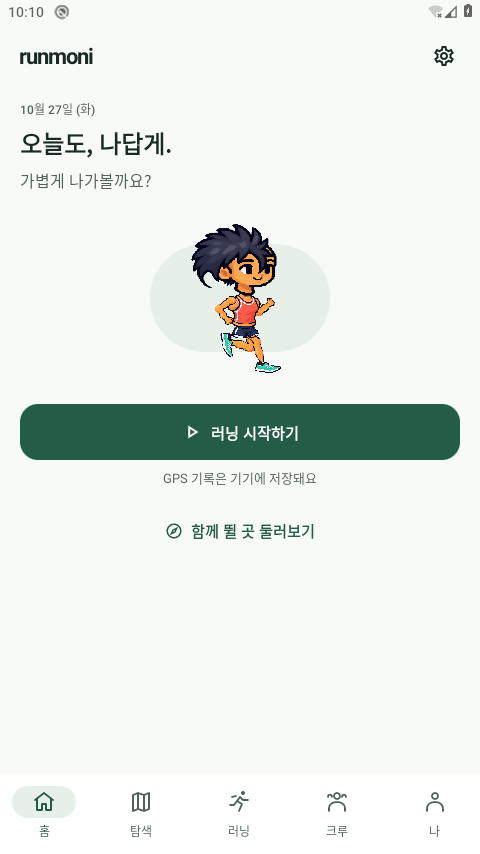
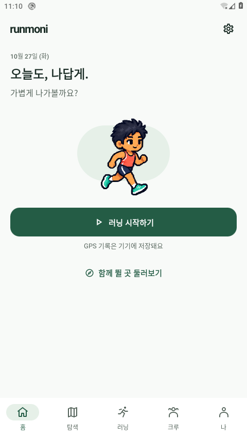

# 2026-10-27 전체 앱 실행·홈 미니미 복구

후속 상태: 아래 기본형 복구 검증은0.1.5-dev/code6에서 수행한 기록이다. 이후 사용자 요청으로0.1.6-dev/code7과 우상단 업데이트 알림을 추가했다. 아래 보존된 APK/이미지/출처를 새 버전의 결과로 바꾸지 않는다. [후속 개발본](RELEASE_NOTES_0.1.6-dev.md)과 [우선순위](DEVELOPMENT_PRIORITIES.md)를 함께 확인한다.

실제 `com.runmoni.app/.MainActivity`를 클라우드 Android 29에서 실행했다. 별도 수영복 검토 앱이나 호스트 GIF 화면이 아니다. 지도/음성 Maven 저장소의 앞선 403은 이 작업에서 200으로 바뀌었고 전체 앱 빌드가 가능해졌다. 이전 실패는 [당시 기록](design/avatars/v0.5.2/README.md)에 보존한다.

## 홈의 잘못된 미니미

사용자가 지적한 홈에는 거절된 v0.4 부품 조립 렌더러가 남아 있었다. 검토 화면에 새 시안을 추가하는 것만으로 홈이 바뀌지 않았던 것이 원인이다. `MiniMi`와 지도 마커의 공용 `avatarBitmap` 경로를 승인된 v0.3 전신 시트로 교체했다. 원화 디코딩과 프레임 준비는 백그라운드에서 수행한다.

| 수정 전 실제 앱 | 수정 후 실제 앱 |
|---|---|
|  |  |

원본 `docs/design/avatars/v0.3.0/running-motion-art-source.png`는 수정하지 않았다. 앱에 복사한 `avatars/v0.3.0/running-motion.png`와 동일한 SHA256 `f9035f29ced0c7ba513dfe24cb727410a7204dc482fc457e806c7a9b3cdbfa65`를 확인한다. 2048×768 시트의 첫 행을 256×384 전신 프레임 8개로 잘라 사용하며, 새 몸통·팔다리 회전이나 조립형 대체 경로를 사용하지 않는다.

**복구 범위는 첫 행 캐릭터의 기본 러닝복이다.** 여자 기본형의 선택 모델과 58종의 프레임별 의상·헤어·장비 레이어는 아직 연결하지 않았다. 현재 `AvatarStyle`의 비기본 선택을 이미지에 반영하지 않으며, 기존 선택을 다시 쓰거나 성별을 헤어에서 추측하지 않는다. 이 상태를 모든 꾸미기 기능 복구로 표시하지 않는다.

9개 옷장 탭·13개 저장 슬롯·58개 아이템 ID, 보유권·포인트·서버 JSON·점유 규칙은 보존한다. 준비되지 않은 아이템은 중립적인 ‘원화 준비’ 표시를 쓰고 구매·착용을 잠시 막았다. 기존 선택은 ‘선택 보관 중’으로 알리고, 홈·나에도 필요한 경우 기본 러닝복 표시 안내를 제공한다. **비기본 아이템의 구매·착용은 이 단계에서 사용할 수 없다.** 기존 선택값이나 보유 내역을 잃게 만드는 마이그레이션은 없다.

수영복과 독립 색상 조작은 계속 별도의 미승인 검토 화면에 있다. 기본 캐릭터의 복구가 수영복·자연스러운 8프레임 동작·전체 레이어의 새 사용자 승인을 뜻하지 않는다.

## 이번에 확인한 앱 기능

다음은 전체 앱의 실제 UI 조작이다. GPS 좌표나 서버 응답을 성공한 것처럼 주입하지 않았다.

| 항목 | 확인 범위 |
|---|---|
| 화면 | 홈·탐색·러닝·크루·나 5개 탭, 설정·옷장·앱 정보 진입 |
| 러닝 | 시스템 위치 권한 허용 → 기록 시작 → 일시정지 → 재개 → 종료 확인 → Room 저장 |
| 저장 복원 | 앱 force-stop/재실행 뒤 해당 기록이 홈에 나타남. 원래 타임스탬프를 확인한 뒤 이번 테스트 기록만 UI 삭제 확인으로 정리 |
| 거리 | 에뮬레이터의 0.00km 테스트 기록. 실제 야외 거리·GPS 정확도 검증이 아님 |
| 탐색 상태 수정 | 연결/인증이 안 된 상태에서 ‘모임이 없음’을 정상 서버 조회 결과처럼 함께 표시하던 문제 수정 |
| 아이콘 | 달리는 사람 실루엣을 경로·시작점·도착점으로 교체하고 빌드 확인. 런처에서 앱 목록을 여는 조작이 성공하지 않아 새 아이콘의 실제 표시·다양한 마스크·기기별 크기는 미검증 |

수정 전 캐릭터가 보이는 초기 캡처와 기본 기능 검증은 캐릭터 복구 전 결과다. [탭 확인](app-review/2026-10-27/tabs-check.json), [실제 러닝 조작](app-review/2026-10-27/real-run-smoke.json), [저장 복원과 정리](app-review/2026-10-27/record-persistence-check.json)를 분리해 보존한다. [저장 완료 화면](app-review/2026-10-27/record-saved.png)과 [복구 전 재실행 화면](app-review/2026-10-27/record-restored-before-avatar-fix.png)은 새 원화의 실행 검증으로 합산하지 않는다.

## 검증과 환경 한계

- 전체 앱 debug APK·Android 테스트 APK 빌드 성공. JVM 30개 통과, lint 오류 0개·경고 57개. 경고가 없는 프로젝트로 표현하지 않는다.
- Android 선택 검사 6개를 실행했다. 최초에는 5개 통과·화면 비교 1개 실패였다. 128×192 축소 화면의 CPU 기대 이미지와 GPU 실제 이미지가 가장자리 픽셀에서 달라, 화면 비교를 원본 256×384 크기로 바꾸어 재실행했고 1개 통과했다. 허용 오차는 기존 채널당3을 유지했다. 실제 비교98,304픽셀 중 최대 채널 차이2, 허용 초과0픽셀이다. [초기 실행](app-review/2026-10-27/instrumentation-initial.txt)·[재실행](app-review/2026-10-27/instrumentation-rendering-recheck.txt)·[실제/기대 이미지와 수치](app-review/2026-10-27/render-fixture/comparison.json)를 보존한다. 이 이미지는 Compose 테스트 fixture이며 홈 화면 캡처가 아니다.
- 원화8프레임의 ARGB 완전 일치·정지 프레임 고정, 준비 중 아이템 구매 차단, 기존 지갑 마이그레이션/13슬롯 저장/포인트 유지, 5탭과 연결 불가 상태 검사를 확인했다. 전체 Android 테스트 suite 통과는 아니다. 기존 모든 옷장 아이템 착용 테스트를 새 그래픽 복구의 증거로 사용하지 않으며, 미완성 레이어를 통과시키기 위해 기존 아이템 착용 단언을 제거하지 않았다.
- KVM 없는 AOSP29 x86_64의 TCG 소프트웨어 에뮬레이션, CPU2/RAM2048MiB, headless SwiftShader다. 두 번째 전체 앱 검증 부팅은 105,858ms. 실제 휴대폰이나 하드웨어 가속 검증이 아니다.
- System UI ANR와 cold-launch `am start -W` timeout이 발생했다. Wait 후 실제 목표 PID·ResumedActivity·화면을 확인했다. 쾌적함·정상 시작 시간·안정적 성능을 입증한 것으로 표시하지 않는다.
- 종료된 qemu PID의 잠금 파일 때문에 재시작이 두 번 실패했다. 살아 있는 전용 AVD가 없고 잠금 소유 PID가 종료된 것을 확인한 뒤 **잠금 파일만 격리**했다. userdata를 초기화하지 않았다. helper가 이 확인·종료 대기를 수행하도록 보완했다.
- 재검증 부팅은131,683ms였고 테스트 APK 갱신의 dex 최적화에도 수분이 걸렸다. 실제 앱 시작 직후 UIAutomator가 null root를 반환한 캡처는 사용하지 않고 계층 준비 후 다시 확인한다. 시간 경과나 도구의 종료 코드만으로 화면 성공을 판정하지 않는다.
- 최종 [나 화면](app-review/2026-10-27/me-approved.png)과 [옷장 화면](app-review/2026-10-27/closet-approved.png)에서도 승인된 기본형을 확인했다. 포인트0·기록0으로 이번 테스트 데이터가 정리된 상태를 확인했다. 런처 캡처 후보는 앱 아이콘을 포함하지 않아 아이콘 표시 검증 자료에서 제외했다.
- Firebase 설정과 Naver 지도 키는 현재 클라우드에 없으므로 Google 로그인·원격 백업·지도 배경 인증을 검증하지 않았다. 지도는 기존 실제 GPS 경로 캔버스 경로를 사용한다. LiveKit·2대 기기 오디오·외부 공개 서비스도 미검증이다.
- 최종 앱 crash 버퍼는0바이트, 종료 전 ResumedActivity는 `com.runmoni.app/.MainActivity`였다. 애니메이션 배율1.0으로 복원·fontScale1.0 확인 후 전용 PID7311만 종료했고 활성 AVD0개를 확인했다. 잠금만 격리하고 userdata를 보존했다. [실행 출처·검사·정리 JSON](app-review/2026-10-27/verification.json)에 범위를 기록한다.

## 이어서 할 작업

1. 승인 원화의 동일 인물을 유지하는 여자 기본형 선택과 프레임별 의상 레이어·앞뒤 가림 순서 연결. 원화가 준비된 아이템부터 구매·착용 재개.
2. 헤어·상의·하의·양말·신발·여러 장비·특수 세트의 조합 확인, 보드숏/비키니 독립 색상 저장을 실제 옷장에 연결. 기존 58개 ID·13개 슬롯·점유 규칙 유지.
3. 팔과 반대 다리의 교차, 여자 화면 왼쪽 팔, 7→0 연결을 실제 재생 화면에서 검토하고 사용자 승인 상태 기록.
4. 실기기 GPS·화면 끔·배터리, 2대 기기 음성/음악, 실제 Google 계정·원격 백업과 커뮤니티 연결 검증.
5. 코스 탐색/공개·브리핑과 계정 복구 구현, 아이콘 크기·런처 마스크 검토, 공개 릴리스 검증. 코스는 현재 설계 단계다.

## 재실행

저장소 루트에서 순서대로 진행한다. 기본 빌드는 offline·작업자1개이며 빌드 전에 전용 AVD를 종료한다. 로컬 테스트 키만 사용하고 기존 서명 APK를 교체·게시하지 않는다.

```sh
python3 scripts/cloud/prepare-android.py
python3 scripts/cloud/runmoni-app.py build --tests --android-tests --lint
python3 scripts/cloud/avatar-review.py start
python3 scripts/cloud/avatar-review.py status  # boot_completed: 1 확인까지 반복
python3 scripts/cloud/runmoni-app.py install --tests
python3 scripts/cloud/runmoni-app.py launch
# 실제 화면·PID·로그를 확인한 뒤 전용 AVD만 종료
python3 scripts/cloud/avatar-review.py stop
```

`am start -W` 반환값만으로 실행 성공을 판정하지 않는다. `com.runmoni.avatarreview`는 별도 검토 앱이며, 위 명령은 실제 `com.runmoni.app`를 빌드·설치·실행한다. 새 작업에서 snapshot 복원은 독립 검증하지 않았다.

cloud-environment-onboarding:setup 지침에 따라 기존 백엔드 설정을 보존하고, 전체 앱 빌드와 위 실행 순서를 환경 설정 초안에 저장했다. 저장 응답은 `saved`/`requires_publish=true`다. 새 작업에 적용하려면 환경 설정에서 검토·저장 후 게시해야 하며, 이번 작업이 환경 게시나 앱 공개 릴리스를 수행한 것은 아니다.

앱 설정은 `0.1.5-dev`/code6을 유지한다. 이번 APK는 로컬 테스트 키의 변경 작업 트리 빌드이며 공개 업데이트가 아니다. **기존 0.1.5 APK의 sourceRevision은 계속 `75c39ca900b140cfb02c1a47807a5955c8b8db7f`**다. 새 문서/원화 또는 현재 main으로 그 출처를 바꾸어 기록하지 않는다. 공개 피드·대시보드 다운로드·버전·릴리스 서명키는 변경하지 않았다.
