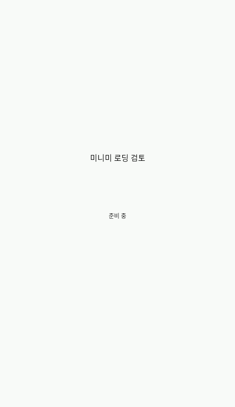
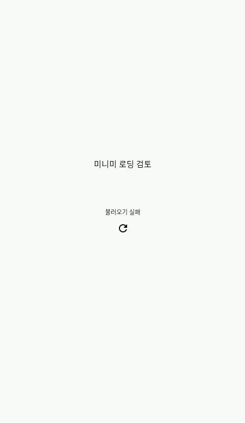
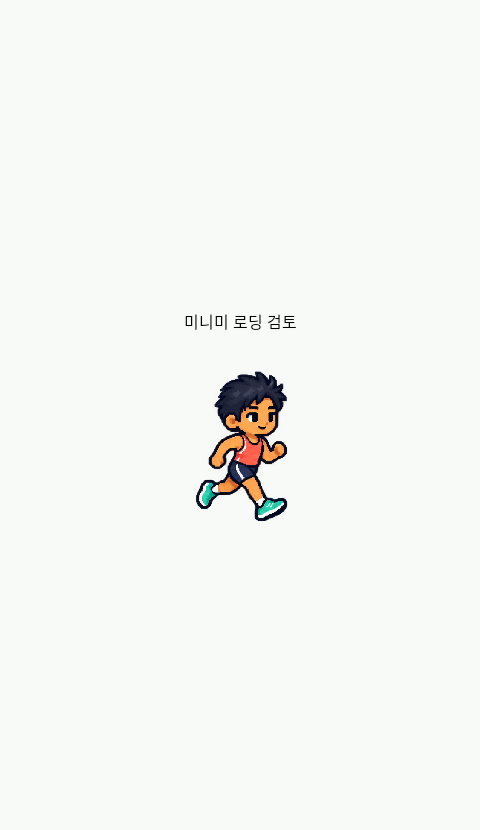
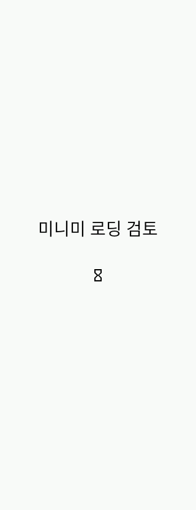
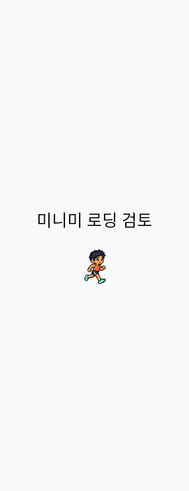

# 첫 미니미 표시와 재시도 / 2026-10-27

이전 버전명/다운로드 검토의320dp 초기 캡처에 미니미가 비어 있었다. `MiniMi`의 비동기 원화 준비가 끝나기 전에는 Canvas가 아무것도 그리지 않고, 읽기 예외도 사용자에게 재시도 경로를 제공하지 않았다.

준비 중에는 ‘준비 중’을 표시한다. 첫 승인 전신 프레임을 먼저 보여주고 나머지 프레임이 준비되면8프레임 순환을 시작한다. 일반 읽기/검사 예외는 오류와48dp 재시도 행동으로 처리하며 취소된 이전 선택은 새 선택의 오류로 바꾸지 않는다. 큰 오류 문구가 들어가지 않는54×64dp 영역은 재시도 아이콘과 접근성 이름을 사용한다.

원본 SHA256 `f9035f29ced0c7ba513dfe24cb727410a7204dc482fc457e806c7a9b3cdbfa65`,256×384 전신 프레임8개,9탭/13슬롯/58개 아이템 ID·보유권·포인트·기존 선택을 보존했다. 거절된 조립형 렌더러로 대체하지 않는다. 여자 기본형/의상 레이어/새 수영복 승인과 별개의 로딩 UI 수정이다.

## 검증 범위

- 읽기를 지연한 동안 준비 표시, 실제 그리기 후 준비 표시 제거.
- 첫 읽기 실패 후 재시도 → 준비 → 승인 원화 표시. 재시도48dp·작은 화면/큰 글씨의 문구 확인.
- 첫 프레임은 보이는 상태로 나머지 프레임을 기다리고, 이후 요청한7번 프레임이 실제 그려지는지 확인.
- 선택 변경으로 취소된 이전 읽기가 새 선택을 오류로 바꾸지 않는지 확인.
- 공유 비트맵의 원본8셀 ARGB 일치·실제 Compose 픽셀 비교·미완성 아이템 포인트 차단 검사와 상단 버전명/다운로드 경로 회귀 검사.

로딩 검사는 실제 Android/Compose에서 I/O를 지연·실패시키는 fixture다. 실제 모든 기기의 콜드 시작 속도·강제 손상 APK·야외 GPS 실행 검증이 아니다. 캡처를 실제 홈 전체 화면이나 새 원화 승인으로 표시하지 않는다. 실행 결과는 아래 최종 절에 원시 로그와 함께 기록했다.

첫 빌드는 BoxWithConstraints의 중첩 Column에서 크기 수신자를 암시적으로 사용해 컴파일 실패했다. 외부 범위에서 표시 조건을 계산하도록 수정했고 재빌드를 통과했다. 컴파일 실패를 Android 실행 성공으로 집계하지 않는다.

첫 Android 기본 검사는8개 중7개 통과·재시도 직후 준비 상태의 가시성1개 실패였다. 같은 가시성 단언을 유지한 채 배치를 기다려도30초 timeout으로 재현됐다. 단순 대기 문제로 처리하지 않고 로딩 상태와 표시 하위 구성을 같은 요청 수명에 묶어 재시도 시 함께 초기화하도록 제품 코드를 수정했다. 원화 I/O gate는 준비 상태가 실제 보이기 전에는 열지 않으며, 수정한 제품 코드에서 픽셀/상태/다운로드 검사를 다시 실행한다. 초기 실패와 재검증 로그는 분리 보존한다.

정식 APK 업로드는 기존 서명키가 현재 클라우드에 없어 계속 차단되어 있다. 공개 피드/대시보드 다운로드와 기존0.1.5 APK의 원본 커밋75c39ca900b140cfb02c1a47807a5955c8b8db7f는 유지한다.

요청 수명을 묶은 수정 후 기본 Android8개가 모두 통과했다. 이어 실제320dp/font2 검사4개 중3개 통과·작은 로딩 문구1개 실패였다. 문단 하단71px가54×64px 상자의 높이를 넘는 것을 확인했다. 작은 영역은 접근성 이름 ‘미니미 준비 중’을 가진24dp 로딩 아이콘으로 바꾸고, 넓은 영역의 문구와48dp 재시도를 유지한다. 글자 크기를 줄이거나 잘림 검사를 완화하지 않는다. 이 추가 수정에서 기본/큰 글씨 검사를 다시 실행한다.

## 최종 검증과 실제 Android 출력

구현 커밋 `7fab0f3dc68e95dc96b7f69cef5f8cf1755e9580`의 기본8개·실제320dp/font2에서4개가 모두 통과했다. [최신 기본 로그](app-review/2026-10-27/avatar-loading/normal.txt)·[최신 큰 글씨 로그](app-review/2026-10-27/avatar-loading/native.txt)·[출처/설정/파일 해시](app-review/2026-10-27/avatar-loading/verification.json). JVM30개 통과, lint오류0/경고57이다. 이전 실패와 중간 성공을 최신 실행으로 합산하지 않았다.

다음은 실제 Android에서 I/O를 제어한 **미니미 컴포넌트 검토 화면**이다. 전체 홈 화면이나 호스트 생성 이미지가 아니다.

| 기본 준비 | 읽기 실패/재시도 | 실제 승인 프레임 그리기 완료 |
|---|---|---|
|  |  |  |

| 320dp/font2 준비 | 48dp 재시도 | 실제 그리기 완료 |
|---|---|---|
|  |  |  |

최신 검사는 승인8셀의 ARGB 일치·Compose 픽셀 비교·미완성 아이템 포인트 차단과 버전명→다운로드 확인도 포함한다. 새 의상58종이나 자연스러운 동작의 사용자 승인, 실제 APK 원격 다운로드 완료를 뜻하지 않는다. 설치값0.1.6-dev/code7, fontScale/애니메이션1.0·기본 화면480×854 복원, 앱 crash 버퍼0바이트를 확인하고 소유 PID20072를 종료했다. 활성 AVD0개를 확인했으며 userdata는 보존했다.

[초기 가시성 실패](app-review/2026-10-27/avatar-loading/initial-normal.txt)·[대기만 보강한 재실패](app-review/2026-10-27/avatar-loading/wait-recheck.txt)·[별도 재현](app-review/2026-10-27/avatar-loading/diagnostic-recheck.txt)·[요청 수명 수정 후](app-review/2026-10-27/avatar-loading/before-compact-normal.txt)·[작은 문구 잘림](app-review/2026-10-27/avatar-loading/before-compact-native.txt)을 보존했다. 재현 도중의 별도 기기 화면 진단 캡처는15초 timeout으로 검증 이미지에서 제외했다.
