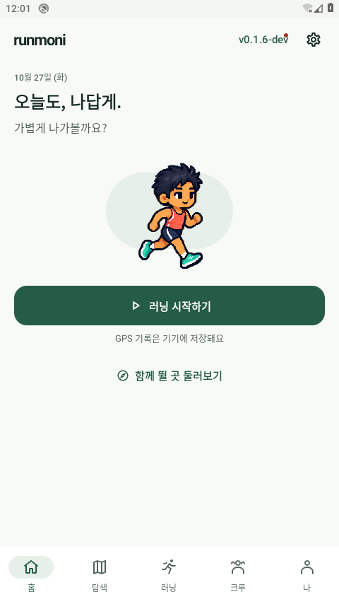
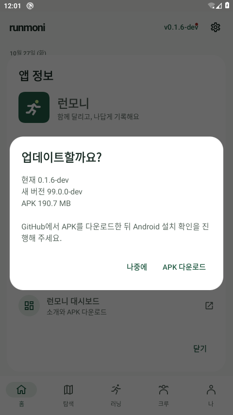

# 버전 노출·업데이트 내역·우상단 알림 — 2026-10-27

최신 UI: 후속 사용자 요청에 따라 우상단의 **설치 버전명 `v0.1.6-dev` 영역**에 점을 붙이고, 이 영역을 누르면 설정을 거치지 않고 새 버전/다운로드 확인으로 이동하도록 바꿨다. 일반 설정 아이콘은 설정용으로 유지한다. 아래 이전 이미지의 설정 아이콘 점은 첫 구현 당시 결과이며, 최신 버전 영역의 화면과 검사는 하단 후속 절에 구분한다.

사용자 확인 요청에서 버전/내역은 기존 코드에 연결됐지만, 메인 우상단 설정 아이콘의 점은 빠진 것을 확인했다. 0.1.6-dev/code7 개발본에서 이를 보완했다. 공개 APK는 여전히0.1.1-dev/code2이며 이 문서가 새 APK 공개를 뜻하지 않는다.

## 동작과 실제 Android 화면

5개 탭의 공용 우상단 설정 아이콘은 `AppUpdateUiState.updateAvailable`을 사용한다. 이 값은 패키지/서명 인증서/자산 링크 등이 신뢰 조건을 만족하고 새 `versionCode`가 설치값보다 클 때만 true다. 설정을 열면 맨 위에 새 버전 안내가 있고 앱 정보의 업데이트 확인으로 이어진다. 다운로드는 사용자 확인 후 링크만 연다. 나중에 선택은 공개 새 버전의 존재를 지우지 않는다.

다음은 **실제 Android에서 앱 UI를 렌더링한 테스트 fixture**다. ‘새 공개 버전이 있음’ 상태를 합성 데이터로 주입했다. 실제 새 릴리스 게시나 원격 피드 조회 성공을 뜻하지 않는다. 호스트 합성 이미지가 아니다.

| 우상단 설정 점 | 설정 상단의 새 버전 안내 |
|---|---|
|  |  |

버전 정보는 BuildConfig의 실제 설치 APK 버전과 함께 표시하며 Android 검사에서 PackageManager의 설치값과 비교한다. ‘나’의 앱 정보 행과 설정의 앱 정보 → 업데이트 내역으로 볼 수 있다. 개발0.1.6은 bundledAppHistory에도 ‘개발 중 · 미게시’로 기록했다. 이전0.1.5 APK의 sourceRevision과 당시 화면은 그대로 보존한다.

## 확인 결과

- 전체 debug/Android-test APK 빌드 성공, JVM30개 통과, lint오류0/경고57.
- 기본480dp/font1에서 Android9개 통과. [원시 실행 로그](app-review/2026-10-27/update/android-normal.txt).
- 우상단 점과5탭·설정 맨 위 안내·확인창·취소 후 점 유지, 현재/과거 버전·미조회/조회 실패·불신 서명 정보에서 점 없음, 검증된 캐시와 재조회 실패 상태를 확인했다.
- 실제 설치 버전/내역/라이선스/외부 링크 진입·다운로드 확인 전 외부 링크0회/확인 후1회도 검사했다. 네트워크 호출 없이 테스트 URL 관찰자를 사용한 검사다.
- 기존 업데이트 controller의6시간 캐시·시계 역행·30초 재시도·동시 확인 요청 방지도 포함한다. 실제 원격 Google 계정이나 APK 다운로드/설치 성공으로 표시하지 않는다.
- 실제 시스템320dp/font2에서 우상단/설정 경로와 긴 앱 정보·다운로드 확인2개가 통과했다. [원시 실행 로그](app-review/2026-10-27/update/android-native.txt), [320dp 설정 안내](app-review/2026-10-27/update/settings-320-font2-fixture.png), [큰 글씨 앱 정보](app-review/2026-10-27/update/about-320-font2-fixture.png)를 보존한다. 폰트 강제 축소 없이 줄바꿈/스크롤을 확인했으며 전체 TalkBack 실사용 검증은 아니다.
- 테스트 후 실제 `com.runmoni.app/.MainActivity`가 실행 중이고 설치값0.1.6-dev/code7임을 확인했다. fontScale/애니메이션1.0·화면480×854로 복원, 앱 crash 버퍼0바이트, 전용 PID10348 종료를 확인했다. [버전/출처/설정 복원 근거](app-review/2026-10-27/update/verification.json). KVM 없는 소프트웨어 실행의 성능 한계는 이전 검증과 같다.
- 앱 정보 검사에서 Android PackageManager가 읽은 [실제 패키지 아이콘](app-review/2026-10-27/update/android-loaded-package-icon.png)을 Android Canvas로 그린 결과도 보존했다. 런처 홈/다양한 아이콘 마스크의 실제 표시 검증과 구분한다.

설정/버전 UI는 awesome-design-md Nike 제3자 분석의 절제된 의미 강조를 참고했다. 점에는 접근성 설명이 있고, 색만으로 안내하지 않도록 설정의 텍스트 카드로 연결한다. 버튼48dp와 앱 정보 스크롤·다운로드 확인을 유지한다.

## 공개와 이전 APK의 경계

소스에 기능이 있어도 과거 설치 APK가 자동으로 수정되지 않는다. 업데이트 확인 기능을 포함한 앱은 새 공개 APK의 피드를 읽어 점을 표시한다. 그 기능이 없는 이전0.1.1 APK에는 레드닷 코드를 소급 적용할 수 없다.

현재 클라우드에는 기존 릴리스 서명키가 없고 GitHub 서명 설정 조회도403으로 제한됐다. 로컬 테스트 키 APK를 정식 업데이트처럼 공개하거나 대시보드 다운로드에 연결하지 않는다. GitHub 소스 PR과 APK 게시/대시보드 배포의 상태를 분리한다. [우선순위와 게시 조건](DEVELOPMENT_PRIORITIES.md)을 따른다.

## 전달 결과

- 앱 구현 커밋 `4113bb9255207bd00bd8969d9c05516c591fe68e`를 원격 브랜치에 푸시하고 [앱 PR2](https://github.com/wjdals988/runmoni/pull/2)를 생성·현재 작업에 첨부했다. 초안/OPEN/병합 가능을 확인했다. 앱 저장소에는 원격 CI 검사 항목이 없어 로컬 검증과 구분한다.
- 깨끗한 위 커밋에서 offline 재빌드를 확인했고, Android에서 검사한 APK와 바이트가 동일했다. 로컬 보존 파일은 `outputs/cloud-review/runmoni-0.1.6-dev-cloud-debug.apk`, 236,794,116bytes, SHA256 `07f5d880cc0227c2f45933dc2c9338e926a9e82937aee183a3511a9be3486e6f`다. debug 인증서 SHA256은 `264eca67962faa6e51d44c050772ef7b836315344cc25d91a5ac41447736b267`다. metadata에는 sourceRevision을 위 구현 커밋으로 고정하며 이후 문서 커밋으로 바꾸지 않는다. 기존 공개 인증서의 업데이트용 APK가 아니다.
- [대시보드 PR9](https://github.com/wjdals988/mydashboard/pull/9)는 소개 문구·개발 상태 정정만 포함한다. 원격 커밋 `8d4a578dac2082ab908a1c30e75f6095dedf2040`에서 다른 프로젝트/순서·기존 APK 메타데이터·공개 릴리스 내역 불변을 다시 비교했다. 기존 Node검사23개 통과, GitHub의 `Test, lint, and build`와 Vercel preview 상태SUCCESS를 확인했다. main 병합·운영 페이지 교체 완료를 뜻하지 않는다.
- 새 정식 APK 업로드·공개 피드·대시보드 다운로드 교체는 기존 서명키 부재로 완료하지 못했다. 기존0.1.1 다운로드를 유지했고0.1.5 APK의 원본 커밋도 바꾸지 않았다. 여자 기본형·58종 의상 레이어·실기기/로그인 검증은 우선순위 문서의 미완료 항목이다.
- 재사용 클라우드 실행 지침도0.1.6와 두 PR/검증 범위에 맞춰 환경 초안에 저장했다(`saved`/`requires_publish=true`). 적용하려면 환경 설정에서 검토·저장 후 게시해야 한다. 환경 초안 저장을 게시나 새 작업 복원 성공으로 표시하지 않는다.

## 후속 — 버전명을 눌러 바로 다운로드 확인

- 상단에 실제 설치 버전을 항상 표시하며, 신뢰한 새 버전이 있을 때만 같은 영역에 점을 표시한다. 선택 시 앱 정보와 현재/새 버전 확인창으로 바로 연결한다. 최신/미조회 상태에서는 앱 정보·버전 내역을 볼 수 있다.
- 확인창을 열거나 ‘나중에’를 선택하면 외부 링크를 열지 않는다. ‘APK 다운로드’를 직접 선택했을 때 검증한 고정 APK 주소만 연다. 앱 내부의 자동 파일 다운로드·자동 설치는 추가하지 않는다.
- 버전 버튼은48dp 이상이며 시스템 큰 글씨에서는 제목과 행동 줄을 나눠 로고·버전·설정이 서로 압축되지 않게 한다. 새 원격 릴리스 게시와 테스트의 합성 릴리스 상태를 구분한다.
- 구현 커밋 `3a51c24adc8f1d38a28d571d7cb31f6caeab2e82`에서 전체 debug/Android-test APK·JVM30개·lint0오류/57경고를 확인했다. Android 기본11개 및 실제320dp/font2에서3개가 통과했다. [기본 원시 로그](app-review/2026-10-27/version-shortcut/android-normal.txt)·[큰 글씨 원시 로그](app-review/2026-10-27/version-shortcut/android-native.txt)·[검증 범위와 제한](app-review/2026-10-27/version-shortcut/verification.json).
- 루트 앱에서 버전명 선택 → 확인창 진입 → 취소 → 재진입 → APK 다운로드 선택을 검사했다. 외부 링크는 확인 전0회·취소 후0회·다운로드 선택 후 정확한 고정 APK URL1회다. 실파일 전송 성공이 아니라 외부 링크 관찰자를 사용한 검사이며 원격 새 APK는 아직 게시하지 않았다.
- 다음은 **합성 새 버전 상태를 주입한 실제 Android UI**다. 99.0.0-dev와 APK190.7MB는 fixture 값이며 실제 게시 버전/파일 크기가 아니다. 이전4113bb9의 APK/로그/해시는 보존하며 새 코드의 아티팩트로 바꾸어 기록하지 않는다.

| 최신 버전명 영역과 점 | 선택 후 APK 다운로드 확인 |
|---|---|
|  |  |

[320dp·글씨200% 다운로드 확인](app-review/2026-10-27/version-shortcut/confirmation-320-font2-fixture.png)에서도 버튼과 설명의 줄바꿈/스크롤을 확인했다. 초기320dp 홈 캡처에는 비동기 미니미가 아직 그려지지 않아 최종 캐릭터 출력 자료에서 제외했다. 버전/다운로드 검사 통과를 초기 캐릭터 표시 완료로 해석하지 않는다.

첫 부팅 대기를 짧게 잡아 준비 확인이 설치를 거절했고,126,207ms 부팅 완료를 확인한 뒤 설치/검사를 재개했다. 검사 후 화면 크기·폰트·애니메이션 복원 명령은 성공했으나, 추가로 시도한 설치 APK의 기기 내 SHA256 읽기는 TCG에서45초 timeout이었다. 전용 PID12966은 finally에서 종료했고 활성 AVD0개를 확인했다. 최신 설치 파일 해시·최종 crash 버퍼·복원값 재조회는 성공으로 기록하지 않는다. 이 부가 확인 실패와11+3개의 UI 검사 통과를 구분한다.
