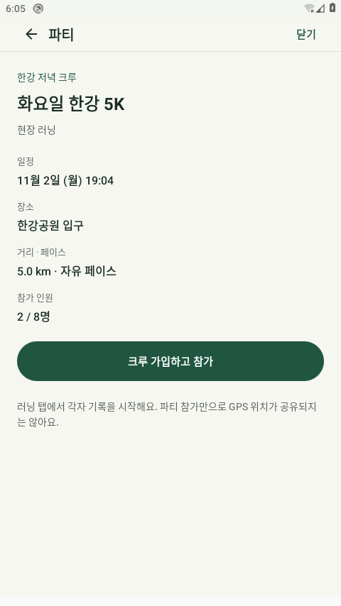

# 0.3 크루·옷장 Android 검토

클라우드 전용 `Runmoni_Cloud_29`, API29/AOSP/TCG에서 실행한 debug 검토다. 실제 휴대폰·하드웨어 가속·Google/운영 Firebase 쓰기 검증이 아니다. 공개 APK 출처와 debug 검토 바이너리의 dirty 출처/해시는 구분한다. [빌드 근거](build-verification.json) · [토론](../../CREW_CLOSET_REVIEW_20261102.md).

## 확인한 실행

| 실행 | 결과 | 경계 |
|---|---|---|
| 오프라인 JVM |45개 통과|실제 기기 실행과 별개|
| debug lint |오류0/경고35|경고는 남아 있음|
| HTTP |38개 통과|로컬 API/기존 Starlette 경고1|
| demo Firestore Rules |119개 통과|[GitHub CI 근거](rules-ci.json), 운영 게시 아님|
| Python 연결/게시 정책 |55개 통과|모의 검증|
| Android Firebase SDK |1개/31.619초 통과|[보고서](firebase-sdk.txt), 한 AVD의 익명 클라이언트3개·로컬 demo 프로젝트|
| 수정 후 계층/뒤로/UI |7개/215.622초 통과|[보고서](focused-native-ui.txt), 실제 키 주입·목적 화면 검사/Android fixture|
| native320dp/글씨200% 옷장 |2개/166.121초 통과|[보고서](focused-native-320dp-font2.txt), 무료 선택·성별·닫기/재열기. 상단/탭 정렬 후속 수정과 구분|

첫 Android 실행은 UI19개 중2개 실패, native320/font2의2개 중1개 실패였다. Back helper의1초 접근성 이벤트 판정과 부분 문구의 전체 일치 검사를 고쳤으며 첫 실패를 성공으로 덮어쓰지 않는다. [첫 실행 분석](first-run-analysis.json). [실행/설정 복원](focused-android-verification.json)을 기록하고 전용AVD PID528139를 종료했다. 실제 MainActivity/loopback과 최종 문구/상단 정렬 빌드는 후속 기록한다.

## 실제 MainActivity와 정렬 후속 실행

최종 계층/실제 MainActivity·HTTP/LocalWallet4개는213.39초, native320dp/font2의1개는94.935초로 통과했다. [MainActivity 원시 보고서](mainactivity-and-hierarchy-native.txt) · [큰 글씨 원시 보고서](final-navigation-native-320dp-font2.txt). 실제 하단 라벨 baseline은 모두801px, 차이0px였다. [측정값](navigation-label-baselines-native-320-font2.txt). 원래 URL/backend/지갑·임시 지급 원장 복원, 원격 러닝0건·부모 크루/다른 파티 보존도 검사했다.

다만 사진은 별도로 검토해 파티 상세 PNG가 크루 상세와 동일 SHA이고 옷장 PNG는 top:1 UI 갱신 전임을 발견했다. 두 사진을 해당 상태의 증거로 쓰지 않는다. 고유 UI 상태까지 기다리도록 캡처를 수정했다. 큰 글씨 프로필 설명도 좁은2열 대신 세로 배치로 바꾸고 새 컴파일(JVM45/lint0오류·35경고)을 통과했다. 프로필 세로 배치의 native320/font2는83.866초에1개 통과했다. 이후 최종 MainActivity의 선택/저장·미업로드·삭제/보존·복원1개는110.626초에 통과했다. [최종 원시 보고서](final-mainactivity-native.txt) · [실행/기기 설정](final-mainactivity-verification.json) · [정리·실제 체크 상태](final-cleanup-and-selection.json). [앞 실행의 경계/정리](mainactivity-followup-analysis.json) · [새 캡처 빌드](capture-profile-build-verification.json).

## 최종 실제 앱 캡처와 접근성 교정

최종 사진은 실제 MainActivity와 로컬 HTTP API의 테스트 계정이다. [홈](mainactivity-home.png) · [크루 목록](mainactivity-crew-list.png) · [크루 상세](mainactivity-crew-detail.png) · [파티 상세](mainactivity-party-detail.png) · [채팅](mainactivity-party-chat.png) · [여자/무료 선택](mainactivity-closet-female-free-selection.png). 파티 상세의 음성 패널은 HTTP 테스트 경로이며 기본 Firebase 화면에는 없다. 운영 데이터/Google/실기기·서명 APK 직접 실행 사진이 아니다.

선택 캡처 검사2회 실패는 `clickable=true` 및 플랫폼 RadioButton 클래스 가정 때문이었다. 실제 XML은 일반 `android.view.View`, `checked=true`, `clickable=false`이며 같은 노드 아래 민트 이름·선택 보관 안내가 있다. Compose1.7의 Selected→checked 및 선택된 RadioButton의 비클릭 노출도 바이트코드에서 확인했다. 클래스 가정을 제거하고 체크·같은 아이템 이름·선택 안내 조건을 유지해 최종 통과했다. [실제 XML](final-checked-closet-accessibility.xml). 첫 실패를 성공으로 바꾸지 않으며 패키지 전용 Searchable의 테스트 컴파일 오류도 공개 API의 조건 반복으로 교정했다.

앱 검토 바이너리 SHA256은 `28a87e3aba9e2c179b2a82bfe65f33251ebd0cb67b79b31bf375c5441b4bf360`, 최종 test APK는 `d3d7187375454c98f60259705510b6d264f9bcdbca2ab1f98f0a6ca768c530af`다. 마지막 프로필 제목 축약 ‘나의 미니미’는 컴파일/JVM/lint로 확인했고 이 debug 앱에는 이전 긴 제목이 남아 있다. 새 서명 APK·실제 휴대폰 검증과 구분한다. font1.0/density160/애니메이션3종1.0 복원·reverse8789 제거, API535457·AVD535309 종료를 확인했다.

## 앞 단계 Android 컴포넌트 출력

480×854 전체 기기 캡처다. 앱 컴포넌트를 Android에서 실제 출력했지만 크루/파티는 `FakeActions`의 테스트 데이터이며 실제 MainActivity/운영 Firebase 화면이나 사용자의 시각 승인이 아니다. 첫 잘못된 파티 캡처는 배경 Activity였으므로 보관 근거에 쓰지 않는다.

선택 범위 밖에서320dp/글씨200%의 워드마크와 하단 러닝 탭 글자가 분리되는 문제를 실제 관찰했다. 그 수정과 해당 화면 재검증이 끝나기 전에는 전체 큰 글씨 UI가 완전하다고 표시하지 않는다. 앱 실행 전 런처의 System UI ANR도 관찰했으며 원인 해결로 기록하지 않는다. 가려진 화면은 갤러리에 사용하지 않는다.

승인 원본 두 행×8프레임/픽셀을 그대로 사용하고 미준비 의상은 선택만 저장한다. 파티 삭제에는 소유자의 새 Rules 운영 게시가 필요하다. 실제 Google 로그인·휴대폰 업데이트/야외 GPS·운영 두 기기 생성/삭제·채팅은 별도 미확인이다.

최종 서브에이전트가6장을 직접 열어 중복 없음·올바른 파티 상세·여자/민트 체크와 미준비 안내·치명적 잘림/OS 팝업 없음으로 검토했다. 사용자 시각 승인은 별도다. [사진별 해시/범위](visual-review.json).
