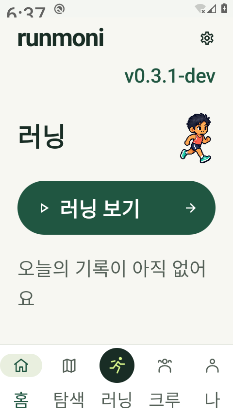
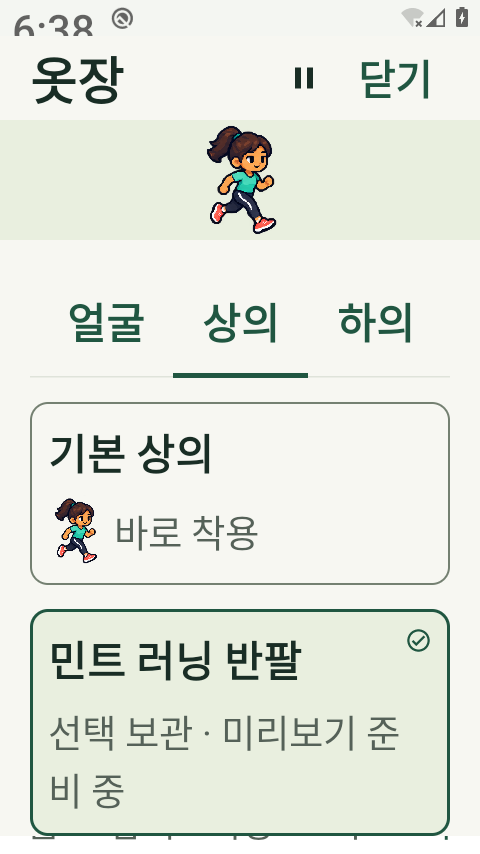
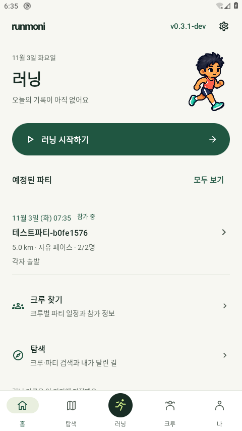
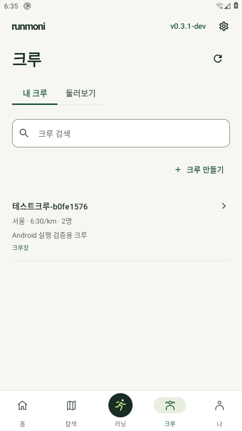
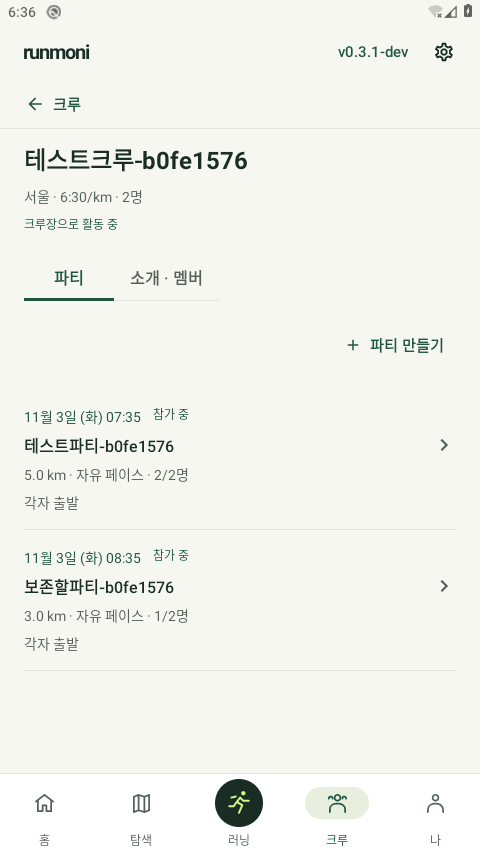
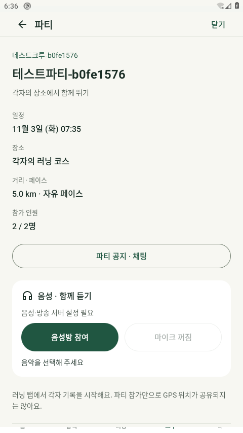
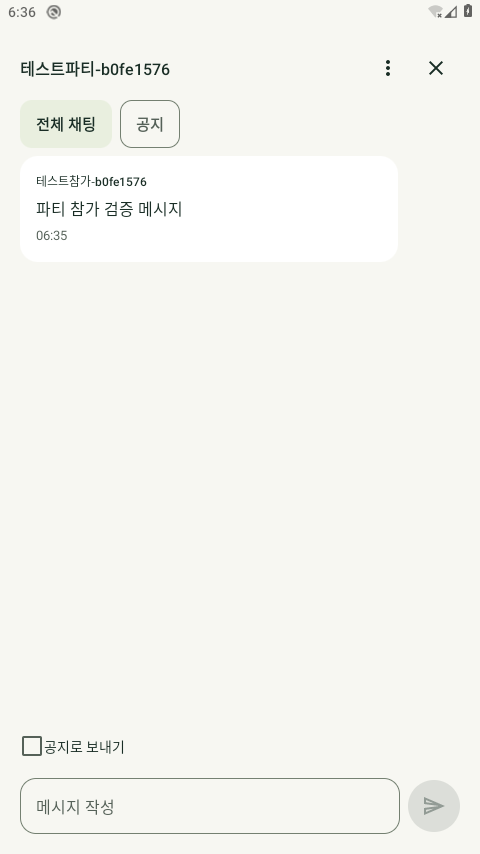
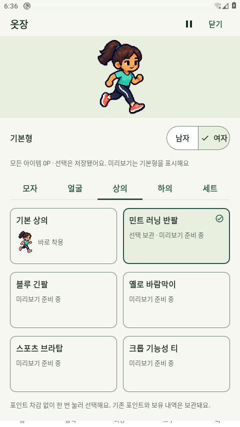

# 0.3.1-dev 사용 맥락 중심 UI 검토 — 2026-11-03 한국 시간

홈의 러닝 시작/실제 기록·일정, 크루별 파티 비교, 옷장 선택/원화 준비 상태를 우선했다. [상호 검토와 채택/기각 근거](../../CONTEXT_UI_REVIEW_20261103.md) · [디자인 기준](../../../DESIGN.md). 같은 pinned awesome-design-md revision의 제3자 분석과 Instagram 풍자를 참고했으며 공식 앱 규격/사용성 실험으로 표시하지 않는다.

## 최종 바이너리와 범위

실제 설치한 debug 앱은0.3.1-dev/code13, SHA256 `a0181d32883e4b174c32dfda76652b50b9853b3006e5d97efef2c277dcac5b28`이다. test APK는 `87e9ab1ef0e0e981acefc612a5a22babce6185c57734577afc48423c493d8c63`이며 기기에 설치된 두 base.apk 해시도 일치했다. [최종 오프라인 빌드/소스 해시](debug-build-verification.json) · [기기 설치 검증](final-installed-verification.json). JVM45개 실패/오류/skip0, debug lint오류0/경고35다. 반복 빌드의 같은 검사를 고유 개수로 합산하지 않는다.

AOSP API29/전용 `Runmoni_Cloud_29`/headless TCG에서 실행했다. 사진의 크루·파티·대화는 task-owned localhost HTTP API의 테스트 데이터다. 실제 휴대폰·공개 서명 release 실행·운영 Firebase 쓰기·Google 대화형 로그인은 별도 미검증이다. 승인 남녀 원본8프레임과 기존 포인트/보유권을 유지하며 미준비 의상은 선택만 저장하고 기본형을 표시한다. 새 원화/의복 색상이나 사용자 시각 승인을 주장하지 않는다.

## 최종 Android 실행

| 실행 | 결과 | 원시 근거 |
|---|---|---|
| 고정 버튼 스크롤 가정을 고친5탭 동선 + 다섯 화면의9개 폭/글씨 조합 |2개/실패0,106.224초|[보고서](final-corrected-five-tabs-and-responsive-home.txt)|
| 실제 MainActivity/로컬HTTP/LocalWallet·남녀/무료 선택·권한/파티 삭제/다른 데이터 보존·정리 |1개/실패0,87.99초|[보고서](final-mainactivity-local-http.txt)|
| 실제320dp/글씨200%의 홈 전체 버튼·남녀/무료 선택·카테고리·뒤로/기준선 |1개/실패0,57.543초|[보고서](final-native-320dp-font2.txt)|

[실행/설정 복원 JSON](final-android-verification.json). 같은 동작을 포함하는 재실행을 고유 테스트 수로 합산하지 않는다. native 홈의 **unclipped** CTA top224/bottom298dp는 nav상단449.33334dp보다 위에 있다. [실제 좌표](final-home-action-unclipped-native-320-font2.json). 초기 부분 노출의 assertIsDisplayed 통과를 전체 버튼 노출로 취급하지 않고 보강했다. 하단5라벨의 실제 baseline은 각각801px/span0px다. [기준선](final-navigation-label-baselines-native-320-font2.txt). dp 좌표와 물리 px 기준선을 혼용하지 않는다.

## 최종 MainActivity 사진

[사진별 SHA/독립 검토 범위](visual-review.json).6장 모두 서로 다른 실제 전체 기기 PNG이며 OS 팝업이 없다. 옷장은 여자 기본형과 민트 항목의 선택 체크·선택 보관 상태를 확인했다. 기본 Firebase에는 없는 HTTP 음성 카드가 나타나는 파티 상세는 대표 대시보드 갤러리에서 제외한다. 나머지5장을 변경 없이 전달한다.

## 초기 실패와 한계 보존

첫 UI 실행은10개 중9개 통과/1개 실패,248.469초였다. 고정된start_run 버튼에 performScrollTo를 호출한 테스트 가정을 고쳤다. 스크롤하지 않고도 고정 버튼이 표시되는지 계속 검사하며 다른 화면은 스크롤/표시 확인을 유지한다. [첫 원시 보고서](initial-ui-flow-report.txt) · [분석](initial-ui-flow-verification.json).

첫 실제MainActivity1개76.56초와 native2개97.97초는 통과했다. 그러나 [초기 native 사진](initial-home-action-native-320dp-font2.png)에서 홈 버튼 하단이 nav 경계에 잘린 것을 실제 시각 검토로 발견했다. [초기 native raw](initial-native-320dp-font2.txt) · [초기 MainActivity raw](initial-mainactivity-local-http.txt) · [초기 실행](initial-android-verification.json). 큰 글씨 헤더를 압축하고 요약을 버튼 뒤로 옮기며 라벨을 짧게 만든 후 위의 최종 실행으로 다시 확인했다. 초기 통과를 해당 시각 문제의 해결로 표시하지 않는다. 보조 오늘 요약의 마지막 한 글자 줄바꿈은 P2 후속 항목이며 현재 주요 CTA는 한 줄/전체 노출이다.

최초 AVD600338은 부팅 중 추가 수정 빌드를 위해 종료해 Android 테스트가 실행되지 않았다. 다음 AVD601147의 앱 설치 전 [SystemUI 응답 지연 창](prelaunch-system-ui-anr.png)을 직접 보고 Wait를 선택했다. [설치/관찰 기록](prelaunch-install-verification.json). 앱 ANR·원인 확인·지연 해결의 증거가 아니다. 최종 AVD603953의 [설치 전](final-prelaunch-launcher.png)과 [설치 후](final-post-install-launcher.png) 사진에는 팝업이 없었다.

최종 font1/density160/애니메이션3종1 복원·reverse8789 제거·API604002/AVD603953 종료를 확인했다. [정리 근거](final-cleanup-verification.json). 테스트 SQLite는 보존한다. 공개 서명 APK/피드/운영 대시보드의 게시 결과는 별도 릴리스 검토에 기록하며, 이전0.3 APK 출처01e37ab를 새 문서 커밋으로 바꾸지 않는다.
