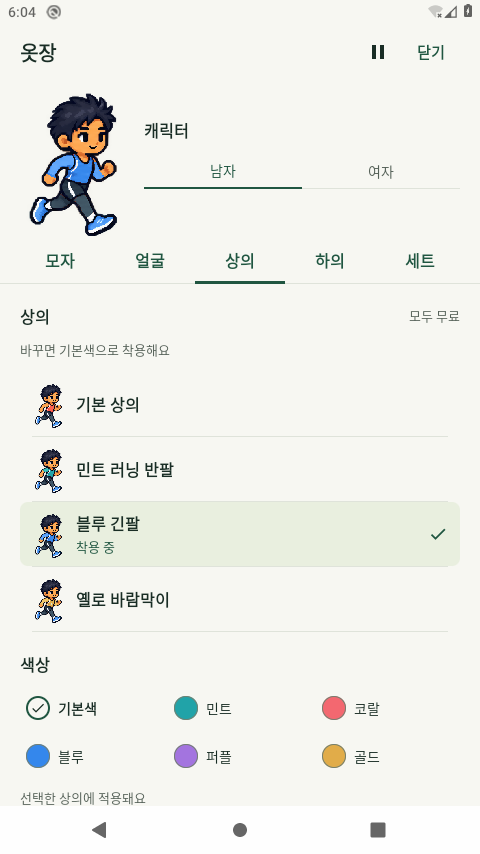
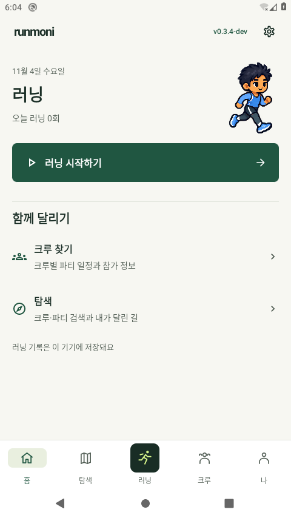
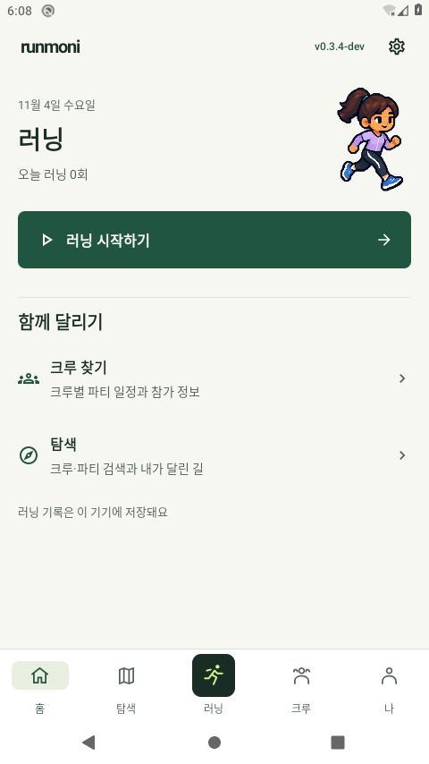
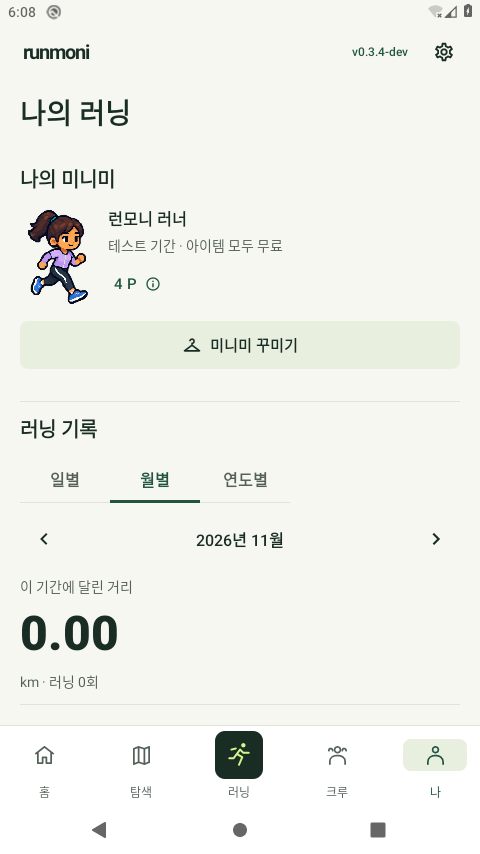
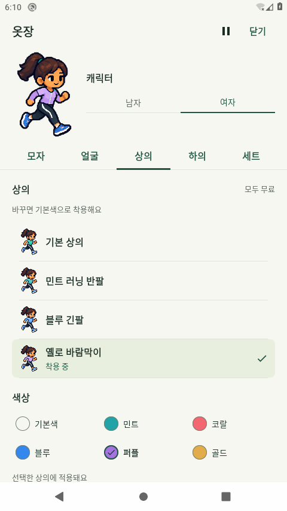

# 0.3.4-dev 옷장·공통 화면 검토 — 2026-11-04 UTC

옷장을 루트 전체 화면으로 분리하고 실제 착용 가능한 품목·색상과 명확한 구획을 연결했다. [구현 검토](../../CLOSET_REDESIGN_REVIEW_20261104.md) · [최종 검증](final-validation.json) · [최종 build7](binary-build7.json) · [기준 build6](binary-build6.json).

## 최종 바이너리와 Android 실행

최종 build7 앱0.3.4-dev/code16은 **로컬 TEST 서명 debug**, `239374156`bytes/SHA256 `dc791196f5669a2c70a53d20062b42ecb8067c56b167260ac86950114d5f8a20`다. test APK는 `4001899`bytes/SHA256 `cfe37b525bea601ac8d906aabe25274e5122f3cb68a88e2217810bcc70204255`다. 각 실행의 설치 app/test 해시와 해당 build6/build7을 각각 대조했다. build7 JVM84개/실패·오류·skip0, debug lint오류0·Fatal0·경고34다.

|채택한 통과 그룹|실행 바이너리|통과 실행 수|실제 소요 시간|원시 결과|
|---|---|---:|---:|---|
|renderer|[binary-build6.json](binary-build6.json)|4|332.72초|[android-final6-renderer.txt](android-final6-renderer.txt)|
|source-color-regressions|[binary-build6.json](binary-build6.json)|7|120.82초|[android-final6-source-color-regressions.txt](android-final6-source-color-regressions.txt)|
|closet-ui|[binary-build6.json](binary-build6.json)|10|330.37초|[android-final6-closet-ui.txt](android-final6-closet-ui.txt)|
|global-ui|[binary-build6.json](binary-build6.json)|5|242.27초|[android-final6-global-ui.txt](android-final6-global-ui.txt)|
|native-320-font2|[binary-build7.json](binary-build7.json)|8|324.01초|[android-final7-native-320-font2.txt](android-final7-native-320-font2.txt)|

검증에 사용한 통과 실행은 **기준 build6의26회 + 최종 build7의 native8회 =34회**다. 동일 바이너리에서34회를 새로 실행한 것은 아니다. build6→7 제품 변경은 `RunmoniChat.kt`1개, 검사 변경은 native 관련2개 파일뿐이고 나머지 소스/렌더 자산 해시는 같다. [변경 경계](source-change-boundary.json)·[원문 diff](build6-to-build7.diff)를 대조해 기준26회를 유지했다. build6의 실패한 native8그룹은 통과로 합산하지 않는다. ConsumerCloset의 환경별 반복도 고유 메서드 수로 세지 않는다.

실제 소프트웨어 하단 인셋 **48px / 72px**는 build6 기본 환경의 보존 좌표와 build7 native의 새 좌표를 구분해 기록했다. dp와 혼용하지 않는다. [원시 경계 좌표](android-final7-navigation-bounds.txt) · [최종 native/복원](android-final7.json) · [기준 실행/복원](android-final6.json). 실제 키 전 포커스를 확인한 Back과 마지막 행/색상 터치를 검사했다. 정확한 System UI 팝업만 Wait 처리하며 검사 그룹 시작 전 아직 실행하지 않은 fixture 포커스는 주장하지 않는다.

검사 wrapper 검토에서 대화상자4개가 실제320dp/글씨200%를 요구함을 확인해 공통 그룹9→5, native 그룹4→8로 옮겼다. 총 실행 수는34로 같다. 시도5는 공통 그룹 실행 전에 실패했으므로 잘못된 환경의 대화상자 통과 결과를 이월한 것은 아니다.

## 실제 MainActivity 외부 입력

[실제 실행](main-final2.json)에서 품목 선택·각 부위 색0 초기화·같은 품목 재선택의 사용자색 유지, 남녀·홈/나 표시와 실제 Android Back 반환을 확인했다. 강제 종료 뒤 이전 PID 부재/새 PID와 프로필 전체 일치를 확인했다. 실제 휴대폰 재부팅·전원 장애 검증으로 확대하지 않는다. 현재 시도 전 전체 XML과 설정을 정확히 복원하고 앱을 중지했다. 비공개 백업 원문은 게시하지 않는다.

사진6장은 촬영 때마다 실제 Main 창 포커스를 확인한 **API29/AOSP/TCG의 로컬 검토 프로필·Firebase 미설정·TEST 서명 debug MainActivity**다. 공개 보관키 release·실제 휴대폰·Google 로그인·운영 Firebase 실행 사진이 아니다. 테스트 컴포넌트 fixture나 호스트 합성 그림을 이6장으로 표시하지 않는다. 호스트 PNG는 [별도 원화 설계 자료](../../design/avatars/wardrobe-v1/README.md)이며 사용자 시각 승인은 대기 중이다.

## 원본·기존 데이터와 선택 계약

승인 원본 SHA256 `f9035f29ced0c7ba513dfe24cb727410a7204dc482fc457e806c7a9b3cdbfa65`의3개 사본을 보존했다. 전체58개 ID 중 기본13+비기본23=**36개가 표시 준비**, **22개 원화는 미준비**다. 0P·성별·기존 보유권·포인트·9분류/13슬롯/58개 저장 ID를 유지한다. 미준비 기존 선택은 보존하되 새 선택을 제한한다. 전체58종·수영복 완성이나 새 사용자 승인을 주장하지 않는다.

새 사용자 선택용 `withSelectedItem`은 다른 의복으로 바꾸면 **해당 부위만 색0**, 같은 품목을 다시 누르면 사용자색을 유지한다. 순수 `withItem`과 codec/이관은 기존 색 보존 계약을 유지한다. 로컬 지갑은 한 번에 저장하며 선택형 HTTP는 선택 슬롯·해당 색만 부분 PATCH한다. 기본 Firebase의 옷장·색상은 기기 저장이며 Google 요약 백업이 원본GPS/포인트/전체 옷장을 복원하는 것은 아니다.

## 초기 실패와 수정 — 최신 통과와 분리

- 준비 단계에서 `ls`의 다열 출력과 `exec-in` stdin 전송을 잘못 가정했다. Android 기능 검사 전에 중단했고, [실패](android-final2.json) 뒤 [정확 복구](android-final2-recovery.json)를 확인했다. `ls -1`·검증한 `shell -T dd`·readback/`.bak` 부재 검사를 적용했다.
- 픽셀마다 성공 메시지를 만드는 느린 검사 시도3은 중단했다. [중단/원문·설정 복원](android-final3-interruption.json)의 완료 그룹은0이며 통과로 세지 않는다. 실패 때만 메시지를 만들도록 검사 코드를 정리했다.
- 이전 build3 후보의 옷장9개 중2개가 실패했다. [실행](android-final4.json) · [원문](android-final4-closet-ui.txt). 실제 Back 뒤 계층 소실과 미니미 로딩 문구 소실에 따른 텍스트 인덱스 경합을 구분했다. 루트 Back 등록/상태 대기와 UI 스레드에서 안정된 텍스트 snapshot을 읽는 방식으로 수정했다. 이전 렌더4·원본색7 부분 통과도 최신34회에 합산하지 않는다.
- build5 시도5는 렌더4/원본색7 뒤 옷장10개 중 Back1개가 실패했다. [실패/복원](android-final5.json) · [원문](android-final5-closet-ui.txt). 이후 System UI 응답없음 팝업을 관찰해 Wait 처리했고 [별도 Main Back 진단](diagnostic-main-back-build5.json)은 통과했다. 이 진단은 전체 Main 흐름이나 fixture 재검증이 아니며 팝업을 실패의 확정 원인으로 단정하지 않는다.
- 별도로 품목 행 미리보기가 실제 선택과 다른 색상 계약을 사용한 문제를 발견했다. build6에서 미리보기도 실제 새 품목/동일 품목 선택 규칙을 따르게 하고 기존 신발 UI 검사에 픽셀 검증을 추가했다. 새 검사 메서드를 늘린 것으로 세지 않으며 Back 실패의 원인/수정으로 혼동하지 않는다.
- build6 시도6의 앞4그룹26회는 통과했으나 [native8개 중2개가 실패](android-final6-native-320-font2.txt)했다. 작은 창에서 새 메시지 이동을 숨기던 실제 채팅 문제와 고정 성별 선택기에 스크롤을 요구한 검사 오류를 구분했다. build7은 메시지 영역 안의48dp 이동 버튼으로 입력 영역 높이를 보존하고, 고정 선택기/접힌 필터는 실제 표시·더보기 메뉴를 검사하도록 고쳤다. 실패한 native6그룹과 그 안의 부분 통과는 합산하지 않으며 최종 build7에서 native8회를 다시 실행했다. Main2도 build7에서 새로 실행했다.
- 독립 원화 검토에서 소매 연결·손 착색·타이츠 발목·밴드 위치·세트 점유 누락을 찾아 coverage/손 보호/슬롯 해석을 보완했다. 호스트 의복864/장비272사례는 Android 실행이나 사용자 승인과 별도다.

실제 휴대폰·Google·운영 두 기기 쓰기·야외GPS/화면 끔·배터리와 사용자 시각 승인은 미확인이다. 새 Firebase Rules·보관키·Secret 변경은 없다. 이 문서의 debug 검증이 공개 APK 게시 완료를 뜻하지 않는다. 기존0.3.3 APK 출처 `abee084b115abfb8693a9fe92c03e024c9adb29d`와 과거0.1.5 출처75c39ca를 새 main으로 바꾸지 않는다.

## 별도 컴포넌트·시스템 바 검사 화면

다음은 실제 Android OS 바를 포함한 ComponentActivity 검증 fixture이며 위6장의 MainActivity 사진 및 대시보드 갤러리와 구분한다. [파일별 바이너리/해시](fixture-review.json).

- [기준 build6 기본 글씨·마지막 선택](fixture-closet-navigation-last-actions-device.png)
- [최종 build7 실제320dp·글씨200%·색상 선택](fixture-closet-navigation-native-320-font2-device.png)
- [최종 build7 실제 키보드·입력/전송 영역](fixture-chat-ime-system-200.png) · [좌표](fixture-chat-keyboard-geometry.txt)
- [하단5탭 글자 기준선](fixture-navigation-label-baselines-native-320-font2.txt) · [홈 전체CTA 경계](fixture-home-action-unclipped-native-320-font2.json)

별도 내부 시각 검토에서 Main6장의 얼굴/체형·의복 가림/색상 일치·필수 조작 표현에 배포 차단 사항을 찾지 못했다. 사용자 시각 승인은 대기 중이다. 초기 접근성 null root/준비 중단·재개는 [중단](build7-setup-preflight-failure1.json)·[읽기 전용 중단](build7-setup-interruption.json)·[실제 설치 전 확인](build7-environment-setup.json)으로 구분한다.
