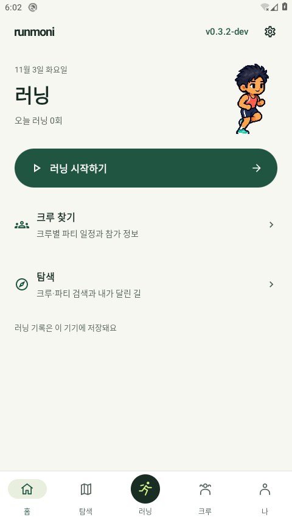
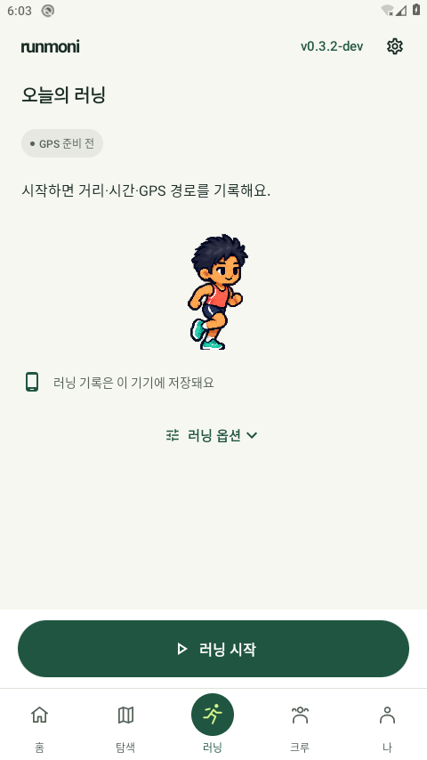

# 0.3.2-dev 기록·계정 신뢰성 실행 검토

2026-11-04 한국 시간. 공개 전 개발 바이너리의 검증이며 실제 휴대폰·Google 대화형 로그인·운영 Firebase 쓰기와 구분한다. [변경/상호 검토](../../RELIABILITY_REVIEW_20261104.md) · [PR24](https://github.com/wjdals988/runmoni/pull/24).

## 최종 바이너리

[빌드·소스 해시](debug-build-verification.json)와 [실제 설치 확인](final-installed-verification.json)이 일치한다. 현재 소스 파일 해시도 다시 대조했다. 최종 debug 빌드는 오프라인·작업자1로 실행했으며 JVM76개 실패/오류/skip0, debug lint오류0/경고34다. [최종 빌드 원문](service-final-debug-build.txt).

- 앱0.3.2-dev/code14, API29 AOSP `Runmoni_Cloud_29`, headless TCG 소프트웨어 실행, 로컬 TEST 서명.
- 앱 SHA256: `11f9650c081fc008969527c48c0a87808abb3aa5727b5c0885ff59e3a5b6f958`.
- 테스트 SHA256: `925a4b1e56d4c59dcc72d0bacc14c80b51ca071b6342227ff279fb4062550596`.
- 로컬 debug에는 운영 Firebase Android 구성이 없다. 별도 로컬 demo SDK 검사는 Auth/Firestore 에뮬레이터에 연결했다. 이 바이너리를 공개 서명 APK로 대체하지 않는다.

## 실행별 결과

| 최종 실행 | 결과 | 실제 범위 | 원문 |
|---|---|---|---|
| 데이터·서비스 |12/12,76.154초|저장 실패/같은 ID 재시도·종료 동결·지갑 commit 실패·중복 적립 방지·복구 상태 알림 제거|[JSON](final-data.json) · [raw](final-data.txt)|
| Compose UI |7/7,130.406초|합성 상태의 저장/복구 실패·고정 하단 재시도·포인트/백업 분리·계정 확인 동선|[JSON](final-ui.json) · [raw](final-ui.txt)|
| 실제 시스템 큰 글씨 |4/4,131.86초|기기 fontScale2.0/density240,320dp; 홈/옷장과 기록/계정 대화상자. 일부 fixture viewport는 별도 override|[JSON](final-native.json) · [raw](final-native.txt)|
| Android Firebase SDK |1/1,30.772초|로컬 demo의 익명3클라이언트·크루/파티·채팅·권한/삭제. 실제 Google/운영 서버 아님|[JSON](final-firebase-sdk.json) · [raw](final-firebase-sdk.txt)|

native와UI의 일부 검사는 같은 시나리오의 조건별 반복이다. 합계를 고유 테스트 수로 표시하지 않는다. 선행 [회귀5개](initial-regression.json)는101.894초에 통과했지만 최종 footer/IO/service 보강 이전 바이너리의 결과이며 최종 바이너리 회귀로 합산하지 않는다.

## 초기 실패와 환경 관찰 보존

- 첫 데이터11개 중10개 통과/1개 실패80.606초. 초기화 완료와 저장중 아님만 기다리던 단언을 실제 creditPending/대상ID 조건으로 수정했다. [원문](initial-data.txt) · [JSON](initial-data.json).
- 첫 UI7개 중5개 통과/옛 문구 선택자2개 실패121.157초. 현재 상태에 맞춰 선택자를 수정하고 하단 재시도/기존 조작 부재 단언을 보강했다. [원문](initial-ui.txt) · [JSON](initial-ui.json).
- 설치 전후 `System UI isn't responding` 팝업과 Wait 조작은 [관찰](prelaunch-observation.json)과 해당 PNG에 보존했다. Runmoni ANR 원인/일반적 해결을 검증한 결과가 아니다. 최종 UI/native·아래 대표 MainActivity 사진에서는 팝업이 보이지 않았다.
- 최초 `mainactivity-home.png`는 Activity resumed 직후의 **빈 프레임**이다. 실행 성공/홈 UI 근거로 사용하지 않는다. 이후 실제 콘텐츠가 표시된 아래 파일을 재수집했다.
- 선행 빌드 해시·설치 기록은 initial/pre-footer/pre-io/pre-service 파일로 보존하며 최종 해시와 혼용하지 않는다. `debug-apk-composition.json`도 초기 debug 후보의 분석이며 새 공개 APK 크기가 아니다.

## 실제 MainActivity 대표 화면

[최종 관찰/사진 해시](mainactivity-final-verification.json). 홈에서 하단 러닝 탭으로 이동한 실제 MainActivity 캡처다. 테스트 상태를 주입한 ComponentActivity 캡처·호스트 GIF와 구분한다. 루트와 독립 출시 검토자가 두 사진을 직접 확인했으며 빈 프레임/시스템 팝업/시작 버튼 잘림을 관찰하지 않았다. 사용자 시각 승인은 별도다.

| 홈 | 러닝 준비 |
|---|---|
|||

큰 글씨의 [종료 실패 하단 재시도](final-ui-run-finish-failed-320-200-device.png), [포인트 처리 대기 상세](final-native-saved-record-credit-pending-320-200-device.png), [홈](final-native-home-active-native-320-font2-device.png)도 별도로 검토했다. 이들은 fixture/주입 상태 UI이며 실제 Google 충돌이나 실제 운영 장애의 재현 화면이 아니다. 한글 보조 문장의 고아 음절 줄바꿈과 버전 행의 위계는P2 개선 여지로 남겼으며 필수 조작이 차단된 것으로 판단하지 않았다.

## 정리와 남은 경계

[설정 복원/종료](cleanup-verification.json): fontScale1.0/density160/애니메이션1을 확인·복원하고 이름을 확인한 전용 AVD PID33576을 종료했다. 소유 로컬 Firebase 포트8080/9099/4400/4500의 listener가 없음을 확인했다. 프로세스 정리는 보안 이벤트 부재나 SystemUI 원인 해결의 증거가 아니다.

실제 휴대폰·실제 Google 선택/충돌·다른 기기의 크루 계정 복구·운영 Firebase 쓰기/권한·야외GPS/화면끔/배터리/TalkBack 전체 동선은 미검증이다. 기존 Google 요약UID와 익명 크루UID의 자동 합치기, 원본GPS·포인트·옷장 전체 백업도 이번 구현 범위가 아니다. 미준비 의복은 그대로이며 승인 원본/무료 선택/성별/기존 데이터를 유지한다. 새 운영 Rules 변경은 없다.

공개 서명 APK의 실제 출처·해시·크기·CI·피드·운영 대시보드 결과는 게시 완료 후 별도 릴리스 검토에 기록한다. 이전0.3.1 APK 출처3074c0f를 새 문서 커밋으로 바꾸지 않는다.
