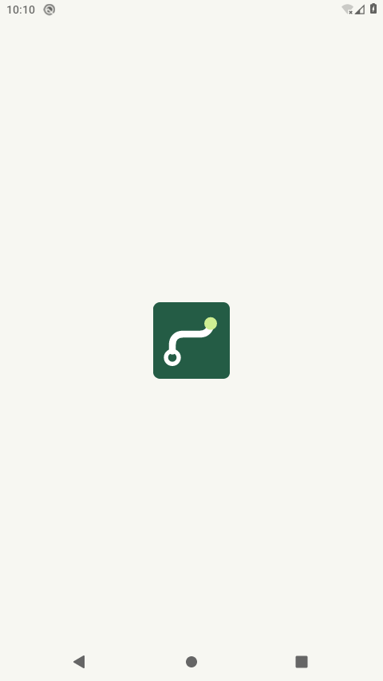
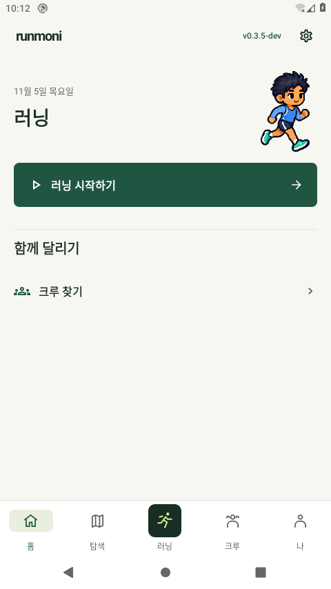
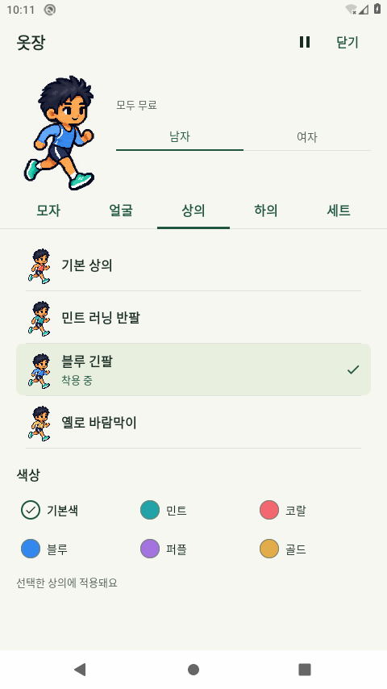

# 0.3.5-dev 시작 화면·문구 실행 근거

2026-11-05 한국 시간. 최종 `binary-build4.json` app/test 조합에서13회는 review3,9회는 review4의 성공 원문으로 확인했고 최종 실행에서 Main/시작 화면을 새로 촬영했다. 같은 app/test SHA이며 실패 그룹과 이전 그래픽 검사를 합산하지 않는다. [review5.json](review5.json) · [실행 드라이버](android-review-driver.py) · [설치 해시](review5-installed.json) · [최종 빌드](binary-build4.json).

API29/AOSP/TCG 전용 Runmoni_Cloud_29, TEST 서명·Firebase 미설정 debug다. 실제 휴대폰·공개 서명 APK·Google·운영 쓰기·Android12이상 실행 결과가 아니다. 일반6사진은 로컬 검토 프로필의 실제 MainActivity/포커스를 확인했고, 아래 채팅 사진은 별도의 UI fixture다. 새 화면의 사용자 시각 승인은 별도다.

|검사|회수|
|---|---:|
|실제 Main 시작·재생성·복귀|2|
|점검·계정 안내·업데이트 확인|6|
|5탭/러닝의9개 폭·글씨 조합·무료옷장·연결실패·위치동의|5|
|전체화면 옷장·Back·마지막 색상/품목|2|
|실제320dp/글씨200% 앱정보·대화상자·채팅IME·옷장|7|

최종 JVM84/실패·오류·skip0, debug lint0Error/0Fatal/35Warning. 최종 app SHA `2e98bcfeb06c5fa5f36d9ea99584f20aedfb0d3de52cb02a2800bdc0a4867d89`, test SHA `3e772ee6f088c8847bbd9de4be9c9e2b94eb86c4b305f6ef7dd44e074254c2c9`. [review5-navigation-bounds.txt](review5-navigation-bounds.txt)의 실제 기본48px/큰글씨72px 시스템 하단 인셋을 확인했다.

## 실제 시작과 화면

OS 시작 창의 [원본 PNG](review5-launch-sample-1.png)를 직접 확인했다. ADB host capture offset은 앱 전체 시작 시간을 측정한 값이 아니다. API31+ 종료120ms는 설정값이며 이 API29 실행에서 확인한 시간이 아니다. 강제 최소 대기·네트워크 대기를 추가하지 않았다.

[프로필](review5-profile.png) · [설정](review5-settings.png) · [앱 정보](review5-app-info.png) · [같은 프로세스로 복귀한 프로필](review5-resumed-profile.png). 실제 UI 선택으로 블루 긴팔을 착용했고 프로필 반영을 확인했다. 원래 포인트·보유권을 보존한 뒤 설치 전 전체 XML과 화면/애니메이션 설정을 정확히 복원했다. 비공개 원문 백업은 work/에만 보관하며 이 디렉터리에 넣지 않는다.

## 이전 실패와 검토 경계

[review1](review1.json)은 실제 OK6인 settings그룹을7로 기대한 wrapper 오류다. 누락 선택한 큰글씨 메서드는 별도의 native 클래스에 있으므로 최종 그룹에 올바르게 배치했다. [review2](review2.json)의 native7개 중1개는 키보드 높이 안정 대기5초를 넘겼다. 두 실행의 passed=false·원문·정확 복원 기록은 보존한다. [review3](review3.json)의 옷장2개 중1개는 클릭/안전영역 확인 뒤 미니미 로딩 완료 대기30초를 넘겨 실패했다. 같은 설치 바이너리로 해당 그룹을 다시 실행했으며 원인 확정이나 실패 통과 합산을 하지 않는다. [review4](review4.json)는 기능 검사9개가 통과했으나 host의 미지원 실행 옵션으로 촬영에 실패했다. [명령 보정](review4-launch-command-correction.json) 후 최종 host 촬영만 새로 진행했다. 기능 검사를 다시 실행한 것으로 세지 않는다. 실패시 [UIA좌표](review2-failed-chat-keyboard-geometry.txt)와 [후속 화면](review2-failed-chat-ime-system-200.png)의 서로 다른 레이아웃 프레임을 확인했고 대기30초·각표본의 실제좌표/Compose전체높이 로그로 보완했다. 전체 입력창과 전송버튼이 IME 위에서 온전히 보이는 조건은 유지했다. [최종 좌표](review5-chat-keyboard-geometry.txt) · [최종 native 채팅 fixture](review5-chat-ime-system-200.png).

부팅 중 System UI ANR에서 정확한 Wait만 선택한 [환경 기록](environment-setup4.json)을 남겼다. Runmoni ANR를 숨긴 결과로 표시하지 않는다. [중간/최종 소스 경계](build-boundary.json). 빌드2/3은 중간 후보이며 Android 합계에 넣지 않는다. 승인 원본3곳의SHA·렌더/자산과 기존 데이터를 유지했다. 원화 추가/시각승인·휴대폰/Google·운영 두 기기·야외GPS·API31이상 실행은 별도다.

App info 사진은 오프라인 환경의 업데이트 조회 실패를 그대로 표시한다. 실제 최신 조회 성공으로 해석하지 않는다. native 채팅 사진·하단 좌표는 review4 원문을 보존해 참조한 것이며 review5에서 해당 검사를 새로 실행하지 않았다. [내부 시각 검토](visual-inspection.json) · [전용 AVD 종료](owned-avd-stop.txt).
