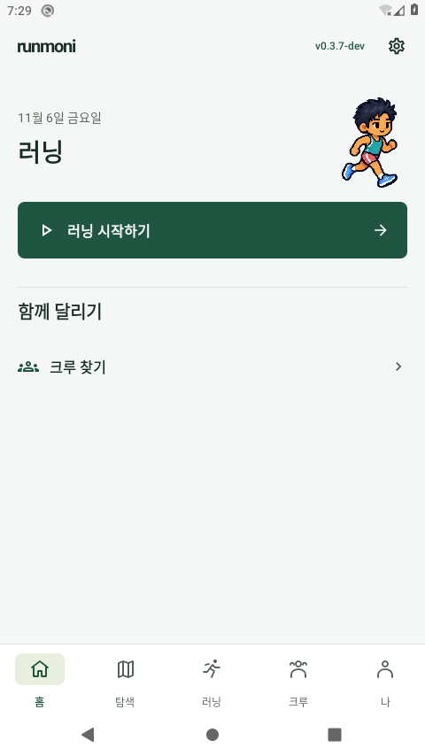
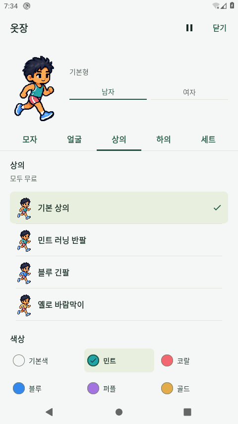
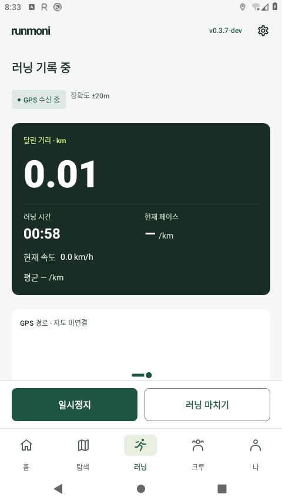
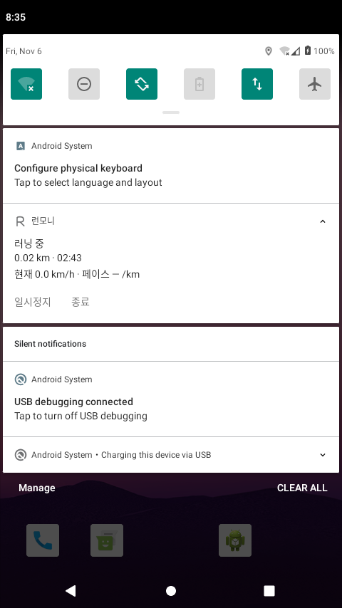

# 전체 UI·백그라운드 러닝 최종 검토 — 0.3.7-dev / code19

2026-11-06 검토 묶음. 최종 호스트 실행 종료는 **2026-11-07 05:55:04 한국 시간**이다. [변경/판단](../../UI_UX_PRO_MAX_REVIEW_20261106.md) · [MASTER](../../../design-system/runmoni/MASTER.md) · [스킬 출처/검색](../../design/ui-ux-pro-max/README.md).

이 문서는 루트의 실제 완료 마커와 `validate_review(jvm_tests=115)`가 통과한 뒤 생성했다. UI/단위 검사·실제 Main/SystemUI·합성 GPS·환경 복원·공개 서명 CI·사용자 승인은 서로 구분한다. 사용자 시각 승인은 **미승인(false)**다.

## 같은 제품 APK와 검사 전용 build4

최종 로컬 TEST 서명·Firebase 미설정 debug 앱은 **239557368bytes/SHA256 `8868750e841f8466e156947727b9f6d9a458765ea20837bae0a9a7a67adf9260`**, test APK는 **4343095bytes/SHA256 `cf655003b791434003879472d66fa9454fff070680c88ed1fe27ad7e8d0be6ee`**다. [최종 바이너리/전체 소스 맵](binary-build4.json) · [빌드 원문](build4.txt). 제품 APK와 제품/리소스/렌더러/설정 소스는 [build3](binary-build3.json)와 동일하다. build4는 미준비 원화 안내에 대한 오래된 검사 기대값 한 블록만 수정해 test APK를 다시 만들었다. [실제 변경 계보](hierarchy-native-test-lineage.json)에서 이전/이후 해시·패치·기본 Hierarchy 클래스 불변을 확인한다.

[build3의 실제 새 JVM 실행](build3.txt)은115개/실패·오류·skip0이며 debug lint오류0/Fatal0/경고39다. build4의 JVM 작업은 `UP-TO-DATE`이고 JVM/lint 근거를 build3에서 유지했다. build4에서115개를 새로 실행했다고 하지 않는다. 이전 BG 후보나 build1의115회도 합치지 않았다. 새 공개 서명 CI의115개 실행은 이후 별도 근거로 확인한다. 역할 대비 토큰12조합은 [수치 근거](contrast.json)를 따르며 야외 화면 시인성·지도 배경 전체 대비를 측정한 것은 아니다.

|독립 실행|통과한 제품 메서드 실행 수|실제 근거|그룹별 원문|
|---|---:|---|---|
|기본 전체|56|[binary-build3.json](binary-build3.json) · [android-review6.json](android-review6.json)|[speed-recovery-data](android-review6-speed-recovery-data.txt) · [recording-regression](android-review6-recording-regression.txt) · [notification-factory](android-review6-notification-factory.txt) · [notification-ui](android-review6-notification-ui.txt) · [main-design](android-review6-main-design.txt) · [dialog-design](android-review6-dialog-design.txt) · [community](android-review6-community.txt) · [hierarchy](android-review6-hierarchy.txt) · [closet-navigation](android-review6-closet-navigation.txt) · [app-information](android-review6-app-information.txt) · [entry-startup](android-review6-entry-startup.txt)|
|실제320dp·글씨200% 기준4|4|[binary-build3.json](binary-build3.json) · [native1.json](native1.json)|[native-closet-navigation](native1-native-closet-navigation.txt) · [native-kit-colors](native1-native-kit-colors.txt) · [native-entry](native1-native-entry.txt) · [native-information](native1-native-information.txt)|
|실제 가로320dp·글씨200%|2|[binary-build3.json](binary-build3.json) · [landscape4.json](landscape4.json)|[active-run-landscape](landscape4-active-run-landscape.txt)|
|오래된 기대 수정 대상1|1|[binary-build4.json](binary-build4.json) · [native2.json](native2.json)|[native-hierarchy](native2-native-hierarchy.txt)|

채택한 제품 메서드는 build3의 기본56+native4+가로2, build4의 수정 대상 native1을 합친 **63회 실행**이다. 같은 제품 APK와 서로 다른 두 test APK의 근거이며 한 pair에서 native5개를 한 번에 모두 통과했다고 하지 않는다. 환경별 반복을 고유 메서드 수로 세지 않으며 관측용 보조 메서드는 제품 검사에 넣지 않는다. `landscape4`는 시도 이름이며 지표 사진4장과 제품 검사2개를 혼동하지 않는다.

원래 [native1.json](native1.json)는 첫4건 통과 뒤 마지막1건이 실패해 **passed=false**다. fixture에 남아 있는 미준비 hair2/socks2의 선택과 안내를 제품이 보존했는데 예전 검사는 안내가 없기를 기대했다. 제품을 바꾸지 않고 안내 표시·이전 선택 보존을 검사하도록 수정한 뒤 [native2.json](native2.json)에서 그 대상1건을 다시 통과했다. [native1-post-source-verification.json](native1-post-source-verification.json)는 실패 뒤·수정 전 측정이며 실패 순간의 스냅샷으로 표시하지 않는다. 첫4건과 수정 대상1건의 출처를 분리하고 원래 실패를 성공으로 바꾸지 않았다.

가로 검사의 제품 메서드는 통과했지만 원래 종료 단계는 API29의 회전 정책 `default→disabled` 복원 문제로 **passed=false**였다. 원문 [landscape4.json](landscape4.json)를 그대로 보존하고, 이후 별도 [landscape4-post-restoration.json](landscape4-post-restoration.json)에서 소유한 설정/회전 정책을 복원했다. 이 후속 복원은 제품 검사0개이며 원래 parent를 성공으로 고치지 않았다. 원래 디스플레이 정책 파일의 바이트/존재 여부까지 같다고 주장하지 않는다.

## 실제 Main13장과 촬영 출처

Main13장과 활성 러닝 세로/가로2장은 [host-review6.json](host-review6.json)에서 build4 pair로 실제 촬영했다. [host-review8.json](host-review8.json)는 **같은 제품/test APK·PNG 원문 해시·원본 host 참조를 확인해15장만 가져왔고, UI/OS조건/활성 지표 촬영을 다시 실행하지 않았다**. 제품 APK는 build3와 같다. 가져온 기록은 `captureCollectedInThisAttempt=false`와 원본 host 참조/SHA를 가지며 최종 호스트에서13장을 새로 촬영했다고 하지 않는다. 예전 host2의8장은 이13장과 별개다.

원본 host-review6는 두 번째 종료 알림 뒤 저장 확인창을 관찰하지 못해 전체 **passed=false**다. UI13/활성2의 완료한 부분 검사와 원본20장 [시각 검토](host-review6-root-visual-review.json)만 채택하고, 불완전한 BG 성공을 가져오지 않는다. 원본과 최종 호스트 각각의 설정/원래 XML·DB 복원을 확인한다. 이번 host-review8의 BG2개는 별도로 새로 실행했다.

아래 사진은 API29/AOSP/TCG·로컬 검토 프로필·TEST 서명/Firebase 미설정 앱의 실제 MainActivity이며 운영 서버·휴대폰·Google·공개 서명 APK 실행 사진이 아니다. 세 지점 픽셀 검사는 검은 프레임을 걸러내는 보조일 뿐이며 가독성/전체 화면 승인을 대신하지 않는다. 루트가 원문 이미지를 열어 실제 시각 마커를 기록했다.

|화면/조건|실제 PNG|촬영 출처|
|---|---|---|
|홈|[host-review6-ui-home.png](host-review6-ui-home.png)|host-review6 원본·host-review8 명시적 재사용|
|탐색|[host-review6-ui-explore.png](host-review6-ui-explore.png)|host-review6 원본·host-review8 명시적 재사용|
|러닝|[host-review6-ui-running.png](host-review6-ui-running.png)|host-review6 원본·host-review8 명시적 재사용|
|크루|[host-review6-ui-crew.png](host-review6-ui-crew.png)|host-review6 원본·host-review8 명시적 재사용|
|프로필|[host-review6-ui-profile.png](host-review6-ui-profile.png)|host-review6 원본·host-review8 명시적 재사용|
|설정|[host-review6-ui-settings.png](host-review6-ui-settings.png)|host-review6 원본·host-review8 명시적 재사용|
|옷장|[host-review6-ui-closet.png](host-review6-ui-closet.png)|host-review6 원본·host-review8 명시적 재사용|
|앱 정보|[host-review6-ui-about.png](host-review6-ui-about.png)|host-review6 원본·host-review8 명시적 재사용|
|실제320dp·글씨200%|[host-review6-ui-largeText.png](host-review6-ui-largeText.png)|host-review6 원본·host-review8 명시적 재사용|
|작은 가로 옷장|[host-review6-ui-landscape.png](host-review6-ui-landscape.png)|host-review6 원본·host-review8 명시적 재사용|
|OS 다크 설정·앱 밝은 테마|[host-review6-ui-systemDark.png](host-review6-ui-systemDark.png)|host-review6 원본·host-review8 명시적 재사용|
|설정 이름 초안·키보드|[host-review6-ui-ime.png](host-review6-ui-ime.png)|host-review6 원본·host-review8 명시적 재사용|
|앱 정보 창 스크롤·닫기|[host-review6-ui-modal.png](host-review6-ui-modal.png)|host-review6 원본·host-review8 명시적 재사용|

조건별 측정/입력은 host-review6의 원본 근거를 유지했다. host-review8에서 OS 모드 변경이나 이 조건들을 다시 실행했다고 하지 않는다:

- nativeFont2: [host-review6-ui-nativeFont2.json](host-review6-ui-nativeFont2.json).
- smallLandscape: [host-review6-ui-smallLandscape.json](host-review6-ui-smallLandscape.json).
- systemDarkLightTheme: [host-review6-ui-systemDarkLightTheme.json](host-review6-ui-systemDarkLightTheme.json).
- imeAndModal: [host-review6-ui-imeAndModal.json](host-review6-ui-imeAndModal.json).

기본 페이지와 별도로 host-review6에서 실제 native 활성 러닝의 세로/가로 거리값 노출을 확인했다. 아래2장도 같은 원본 해시/출처로 가져온 사진이다:

- portrait: [host-review6-main-native-320dp-font2.png](host-review6-main-native-320dp-font2.png).
- landscape: [host-review6-main-running-landscape-font2.png](host-review6-main-running-landscape-font2.png).

이 Main 측정은 UIAutomator가 노출한 경계와 스크롤 viewport/OS 프레임의 관계다. 해당 관찰에서 자연 텍스트 전체 크기를 직접 측정했다고 하지 않는다. 아래 별도 native fixture는 전체 측정 텍스트·고정 조작·OS 경계를 검사한다. 서로 다른 근거를 하나의 측정으로 합치지 않는다.

## 가로 지표 fixture4장

[실제 가로 지표 시각 검토](landscape4-root-visual-review.json)에서 루트와 독립 검토자가4장 원문을 확인했다. 각 사진의 목표 거리/시간/페이스/속도와 단위는 고정 일시정지/마치기·5탭·OS 바와 겹치지 않았다. 다른 지표의 스크롤 경계 잘림과 목표 지표의 차단을 구분했다.4개 지표를 동시에 한 화면에서 읽었다는 뜻은 아니다.

- [landscape4-active-landscape-native-font2-run_distance-fixture.png](landscape4-active-landscape-native-font2-run_distance-fixture.png) — ComponentActivity/fake callback fixture.
- [landscape4-active-landscape-native-font2-run_duration-fixture.png](landscape4-active-landscape-native-font2-run_duration-fixture.png) — ComponentActivity/fake callback fixture.
- [landscape4-active-landscape-native-font2-run_pace-fixture.png](landscape4-active-landscape-native-font2-run_pace-fixture.png) — ComponentActivity/fake callback fixture.
- [landscape4-active-landscape-native-font2-run_speed-fixture.png](landscape4-active-landscape-native-font2-run_speed-fixture.png) — ComponentActivity/fake callback fixture.

이4장은 실제 native OS 조건의 ComponentActivity/fake callback·data fixture다. 실제 Main/foreground service/실제 GPS 진행이나 실제 알림 조작을 대신하지 않는다. 사용자 승인은 false다.

## 실제 BG 두 시나리오와 대표 사진

실제 Main/FGS 흐름은 [host-review8.json](host-review8.json)에서 새로 실행한 별도 **2시나리오**다. host-review6의 실패한 BG 시나리오는 성공으로 가져오지 않았다. 합성 GPS를 주입해 홈 이동/화면 끔 동안 거리·점·시간/속도의 진행, 실제 SystemUI 알림의 일시정지/재개와 설정→러닝 복귀, 강제 종료/새 프로세스의 마지막 확정 지점 복구를 확인했다. 일시정지 중 위치 구독/wake lock 해제와 수치 고정, 구간별 저장 거리의 일치를 검사했다. 강제 종료 후 자동 재시작·관측하지 않은 구간의 거리 추가·야외 GPS/Doze/OEM 동작 성공은 주장하지 않는다.

대표 홈/옷장 사진은 host-review6 원본을 명시적으로 재사용한다. 활성 러닝/알림은 host-review8의 새 합성 GPS 촬영이고 알림 사진은 **실제 SystemUI**다. UI 사진과 BG 사진의 촬영 시도를 구분한다.

홈 — host-review6 촬영·명시적 재사용.

옷장 — host-review6 촬영·명시적 재사용.

활성 러닝 · 합성 GPS — host-review8 새 BG 촬영.

SystemUI 러닝 알림 · 합성 GPS — host-review8 새 BG 촬영.

## 실패와 채택 경계

|보존한 근거|실제 상황과 제외 범위|
|---|---|
|[android-review1](android-review1.json)|21회 통과 뒤 준비/검사 단계 중단. 최종 횟수에 더하지 않음|
|[android-review2](android-review2.json)|42회 통과 뒤 예전 채팅/앱정보 검사 실패. 실패 그룹 부분 통과도 제외|
|[android-review3](android-review3.json)|40회 통과 뒤 옷장 미니미 준비30초 대기 실패. 원인 미확정이며 최종 제품의 성능/정상 동작 근거로 바꾸지 않음|
|[별도 smoke1](chat-smoke1.json)|수정한 예전 검사 경로1회 확인. 새 전체 실행 수에 합산하지 않음|
|[android-review5](android-review5.json)|raw 데이터6개는 통과했지만 선택적 준비 trace 부재를 수집기가 잘못 처리해 parent counter0/실패였다. 원문/카운터를 고치거나 새 전체 실행에6을 더하지 않음|
|[native1](native1.json)|첫4건만 채택. 마지막1건의 예전 안내 부재 기대가 실패했고 parent는 false로 보존. 같은 제품의 수정 검사1건은 별도 build4/후속 원문에 기록|
|[host1](host-review1.json)·[host2](host-review2.json)|선택된 라디오의 실제 클릭 대상/접근성 투영에 대한 수집기 가정 실패. 원래 실패와8장 원본을 보존하며 새 host 전체 성공으로 표시하지 않음|
|[host3](host-review3.json)·[host4](host-review4.json)|통제 중단과 OS night-mode 준비 확인 실패. 일부 사진을 완성된 조건/전체 호스트 성공으로 세지 않음|
|[host5](host-review5.json)|검은 프레임과 실제 활성 러닝 가로 P1 가독성 문제를 구분해 거절. 중단/정리와 [시각 거절](host-review5-active-running-visual-rejection.json)을 보존하고 build3에서 새로 검증|
|[host-review6](host-review6.json)|두 번째 알림 종료에서 저장 확인창을 관찰하지 못해 전체 실패. 완료한 UI13/활성2의 실제 사진15장만 같은 pair/출처/해시로 채택하고 BG 성공은 가져오지 않음|

[검은 프레임 거절](host-review5-main-running-visual-rejection.json)은 원인 미확정이며 자체로 제품 고장이라고 단정하지 않는다. 반면 당시 활성 가로에서 핵심 수치가 좁은 viewport에 완전히 나타나지 않는 문제는 실제 P1이었다. 노출 bounds만 통과한 것을 가독성 통과로 사용하지 않았다. source Before/After/Final의 실제 관찰 시점을 구분하며 [실패 뒤 측정](android-review3-post-source-verification.json)을 과거 실패 순간의 스냅샷으로 바꾸지 않는다.

host-review6의 [별도 관찰](host-review6-activity-notification-observation.json)은 두 번째 종료 알림 탭 뒤 SystemUI shade가 열려 있고 저장 확인창이 보이지 않았음을 기록한다. 첫 종료창과 취소 후 FGS 유지는 확인했지만 입력 누락·알림 전달·앱 처리 중 어디가 원인인지는 미확정이다. 제품을 바꾸지 않고 수집기가 실제 activity 응답을 제한된 횟수로 확인하도록 보완했다. 실패 탭을 무조건 성공으로 바꾸거나 지연 시간 보장으로 해석하지 않는다. 최종 BG 성공은 새 host-review8의 별도 실제 근거를 따른다.

## 보존과 아직 남은 확인

검토용 기록은 지우고 원래 DB 내용·전체 앱 설정 XML/프로필을 복원했다. 환경 복원은 소유한12개 설정 키·WM 크기/밀도·관찰한 night mode·이 앱의 런타임 권한/flags·Awake/Asleep 상태로 한정한다. 무관한 OS 자동 변경을 비교/롤백하거나 OS 설정 전체를 복원했다고 하지 않는다. 비공개 XML/DB/백업 원문은 이 문서에 복사하지 않는다.

승인 원본3복사본 SHA256 `f9035f29ced0c7ba513dfe24cb727410a7204dc482fc457e806c7a9b3cdbfa65`, 58ID/9분류/13슬롯·준비36(기존13+추가23)/미준비22·0P·성별·기존 선택/보유권/포인트/저장을 보존했다. 이번 UI 적용을 새58종 원화 완성·사용자 시각 승인으로 표시하지 않는다. 작은 한글 조사 줄바꿈이나 앱정보 배경 분리는 P2 개선 대상으로 보되 정상 스크롤 경계의 부분 노출을 P1로 세지 않는다.

실제 휴대폰/Google/운영 쓰기·야외 GPS/화면 끔 장기 관찰·Doze/OEM 절전·배터리·Android12 이상 실행·사용자 시각 승인은 별도다. 현재 공개 APK `0.3.6-dev`의 실제 출처 `d27b31f85eafa42eb4c96fe17ff2483536d919f0`를 이 debug 문서나 새 main으로 바꾸지 않는다. 새 공개 APK의 sourceRevision은 이후 실제 서명 CI/공개 자산에서 확인한 값으로 기록하며 이 로컬 sourceCommitAtBuild를 공개 APK 출처로 사용하지 않는다.
