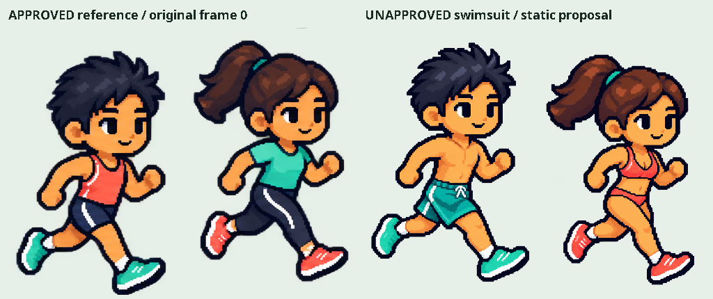
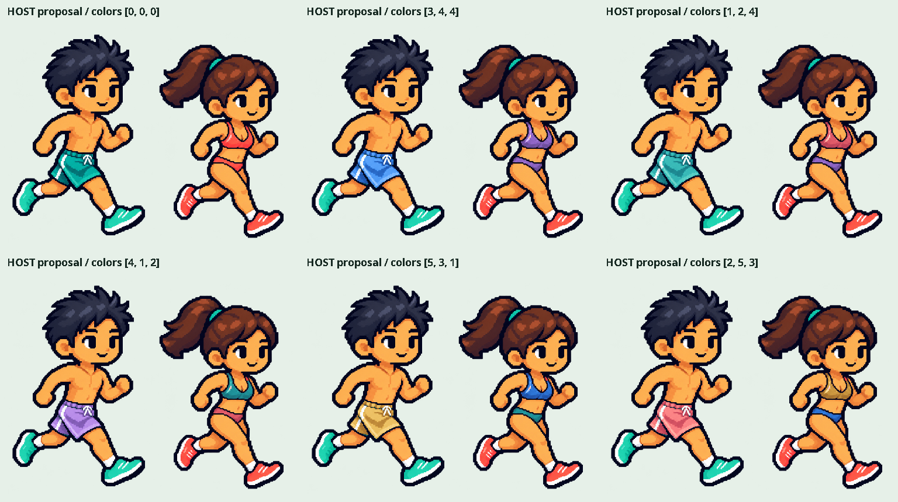
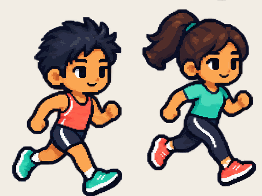

# 의복 마스크·원화 비교 검토 — 2026-10-27

**개발 중인 검토 기능이다. 캐릭터 복구 완료·새 수영복 승인·Android 실행 완료가 아니다.**

이 문서는 최초 정지 시안 검토 단계다. 후속 수영복8프레임·실제 Android 검토 앱 실행과 한계는 [v0.5.2](../v0.5.2/README.md)에 별도로 기록한다. 아래 미실행 항목은 당시 범위이며 새 결과를 과거 검사에 합산하지 않는다.

사용자는 비교 결과를 보고 더 세련되고 깔끔하게 수정해 진행하도록 요청했다. 이를 v0.5 얼굴·체형이나 이번 출력의 승인으로 기록하지 않는다. 승인 기준은 여전히 v0.3의 원본 전신 원화이며, 기존 v0.4 관절 조립 렌더러는 거절된 상태다.

## 이번 구현

- 옷장 → **원화 · 수영복 시안 비교**에 별도 검토 화면을 추가했다. v0.3의 남녀 각 8개 셀을 그대로 잘라 90ms 간격으로 재생한다. 관절 회전·신체 재생성·포즈 보정은 하지 않는다. 일시정지, Lifecycle 중단, 시스템 애니메이션 비활성 설정을 따른다.
- v0.5 민트/코랄 시안 한 장에 보드숏·비키니 상의·비키니 하의의 명시적인 마스크를 작성했다. `red=의복 ID`, `green=명암 0..255`, `blue=0`, `alpha=255`이며 나머지는 alpha 0이다. 세 영역은 서로 겹치지 않는다. 마스크는 원본과 같은 1448×1086이다.
- 원본 유지 + 민트·코랄·블루·퍼플·골드의 6가지 선택을 각 의복에 독립 적용한다. 런타임은 피부색 추정이나 전체 hue 변경을 하지 않고 마스크와 5색 명암 팔레트만 사용한다. 최초 출력에서 확인한 거친 색 단계는 팔레트 사이 보간으로 완화했다. 하얀 장식과 마스크 밖 경계는 원래 색이 남으며, 전체 의복 픽셀의 완전한 분리가 끝났다는 뜻은 아니다.
- 선택은 별도 SharedPreferences `avatar-reference-review-v1`에 명시적 저장/복원한다. 잘못된 팔레트 값은 원본 색으로 정규화한다. 기존 프로필·지갑·아이템 ID·서버 JSON에는 넣지 않는다. 구매나 실제 착용을 제공하는 화면이 아니다.
- 화면은 세로 스크롤과 줄바꿈 색상 버튼, 최소 48dp 조작 영역을 사용한다. 작은 화면/큰 글씨/TalkBack의 실제 Android 확인은 남아 있다.

## 출력

모두 **호스트 Java/ImageIO 출력**이며 실제 Android 앱 스크린샷이 아니다. PNG는 검토용 축소/배치 출력, GIF는 색 양자화가 포함된 편의 출력이다. 픽셀 보존 검사는 축소 이미지나 GIF가 아닌 원본 크기의 ARGB 배열을 비교했다.







원본 셀의 앵커 편차·여자 화면 왼쪽 팔의 움직임·7→0의 자연스러움은 이번에 수정되지 않았다. GIF의 프레임 수를 동작의 시각적 승인으로 바꾸어 설명하지 않는다.

## 프레임별 의복 레이어 설계와 남은 제작

현재 v0.3은 합쳐진 PNG다. 숨겨진 피부·의복 뒷면·가려진 팔의 원화는 들어 있지 않다. 따라서 마스크 색 변경만으로 브라탑·보드숏·비키니의 **형태 교체**나 숨겨진 신체 복원이 완성되지 않는다. 이 검토의 단일 포즈 마스크를 8프레임에 재사용하거나 부품 회전으로 대신하지 않는다.

후속 제작은 256×384 셀 좌표를 고정한 **프레임별 원화 레이어**를 사용한다. 얼굴·체형은 원본과 직접 비교하고, 새 신체 부품 리그를 만들지 않는다.

| 순서 | 레이어 | 가림·보존 조건 |
|---|---|---|
| 1 | 뒤쪽 헤어·뒤 장비 | 원래 머리/목 비율 유지, 앞 얼굴을 바꾸지 않음 |
| 2 | 먼 다리·신발·먼 팔 | 각 프레임에서 기존 실루엣과 겹침 위치를 따로 확인 |
| 3 | 몸통 의복·하의·양말 | 피부 베이스가 필요한 형태는 원화 편집 후 별도 검토. 기존 옷을 피부색으로 칠하지 않음 |
| 4 | 조끼·벨트 | 기존 점유 규칙을 사용, 슬롯·가격 계약 유지 |
| 5 | 가까운 팔·손·워치 | 손이 의복 앞으로 오는 프레임의 가림 마스크를 개별 작성 |
| 6 | 원래 얼굴·앞 헤어·머리/귀/눈 장비 | 의복 선택으로 얼굴/체형 교체 금지, 부위별 장비 중복 점유 금지 |

각 의복에 프레임별 RGBA 레이어와 의복 전용 색 마스크를 제공하고, alpha·얼굴 보호·실루엣·부위 가림을 검사한 뒤 8프레임 순환을 눈으로 검토한다. 얼굴 보호 검사는 생성 모델의 닮은 정도가 아니라 고정된 원본 픽셀/좌표와 비교한다. 필요 시 비의복 영역은 원본을 그대로 사용한다. 사용자가 거절한 결과를 수치 검사 통과로 승인 처리하지 않는다.

헤어·상의·하의·양말·신발 전체 58종의 새 레이어와 특수 세트, 실제 옷장 착용/지도 렌더러로의 전환, 여자 양팔 동작 수정은 **미구현**이다. 현재 `MiniMi`와 `MapPane`의 v0.4 경로는 복구되지 않았다.

## 이번 실행 근거

| 검사 | 결과 | 범위 |
|---|---|---|
| 원본 해시·번들 사본 비교 | 통과 | v0.3과 v0.5의 기존 파일 보존 |
| 실제 PNG의 6³ 팔레트 조합 | 216조합 통과 | 마스크 밖 변경 0, alpha 보존, 세 영역 독립, 원본 선택 시 전체 ARGB 동일 |
| 마스크 픽셀 수 | 23,007 / 7,805 / 3,212 | 보드숏 / 비키니 상 / 비키니 하. 의미 영역 전체의 완전성 점수는 아님 |
| 원화 셀 직접 비교 | 8쌍 통과 | 남녀 16개 셀의 모든 픽셀을 원본 위치와 비교 |
| GIF 재디코딩 | 512×384, 8프레임 | 여자 영역 잘림 없음. 기존 단독 256×384 출력 및 서로 다른 크기 거부도 확인 |
| 기존 `AvatarArtTest` | JUnit 6개 통과 | 카탈로그·점유·기존 저해상도 래스터 회귀. 새 수영복의 Android 검사와 구분 |
| 새 화면·저장 어댑터 소스 컴파일 | 통과 | Kotlin 2.0.21, Android API 36, Compose 1.7.0, Material3 1.3.0. 전체 앱 컴파일 아님 |
| 전체 APK / 실제 앱 캡처 / SharedPreferences 실제 재시작 | 미실행 | 완성된 SDK/Gradle 캐시·기기 없음. 지도 Maven 저장소 요청도 CONNECT 403 |

첫 호스트 실행은 `javac` 실행 파일이 없어 실패했다. Maven Central의 Eclipse ECJ 3.39.0을 TLS 및 공식 SHA-1로 검증해 실행했다. 후속 확인에서 기본 Java21에 compiler 모듈은 있었으므로 ‘JRE만 있다’는 최초 진단은 정정한다. 검토 중 공통 GIF writer가 256px 폭으로 고정되어 남녀 출력에서 여자를 잘라내는 결함을 발견했다. 실제 프레임 크기를 사용하도록 수정하고 GIF 재디코딩 회귀 검사를 추가했다. 초기 GIF는 최종 결과에 포함하지 않는다. 호스트 Fontconfig의 쓰기 캐시 경고는 있었으며 출력과 검사는 exit 0으로 완료됐다.

Android API jar는 Google `platform-36_r02.zip`과 공식 repository XML의 SHA-1 `2c1a80dd4d9f7d0e6dd336ec603d9b5c55a6f576`로 확인했다. Kotlin·Compose·검사 도구는 공식 Maven의 배포 체크섬을 확인한 별도 `work/` 캐시에만 준비했다. 앱 의존성은 추가하지 않았다. 전체 Android 빌드는 `repository.map.naver.com` 접근 허용과 Gradle/SDK build-tools 준비가 더 필요하다. 이 작업에서 네트워크 정책·프록시·방화벽·외부 서비스 설정을 변경하지 않았다.

## 재현

JDK가 있는 환경에서는 저장소 루트에서 실행한다. 검사는 네트워크나 설치를 자동 실행하지 않는다.

```sh
bash scripts/avatar/check-reference-review.sh
# 현재 클라우드는 javac 대신 검증한 ECJ를 사용했다.
ECJ_JAR=work/avatar-reference-review/tools/ecj-3.39.0.jar bash scripts/avatar/check-reference-review.sh
# 작성 도구: Pillow가 있을 때, 원본 PNG는 읽기만 하고 마스크/manifest만 재생성
python3 scripts/avatar/build-swimwear-mask.py
# 이 작업에서 준비한 검증된 도구 캐시가 있을 때의 격리 소스 컴파일
python3 scripts/avatar/check-reference-ui.py
```

색상 조합 번호는 `[보드숏, 비키니 상의, 비키니 하의]`이며 `0 원본 / 1 민트 / 2 코랄 / 3 블루 / 4 퍼플 / 5 골드`다. 개별 원본 크기 출력은 `work/avatar-reference-review/colorway-*.png`에 생성된다. 검사 요약은 [verification.json](verification.json), 원화/마스크 해시는 앱 자산의 `avatars/reference-review/review-manifest.json`에 있다.

앱 버전은 0.1.5-dev/code6인 작업 중 소스 상태다. 기존 APK의 sourceRevision `75c39ca900b140cfb02c1a47807a5955c8b8db7f`를 변경하지 않는다. 이번에 APK를 만들거나 기존 서명본을 재현·게시하지 않았다. 공개 업데이트 피드와 대시보드 다운로드도 변경하지 않았다. 새 그림을 image_gen으로 만들거나 Aseprite를 실행한 작업이 아니며, 사용자 제공 기준과 기존 시안의 권리를 새로 주장하지 않는다.
