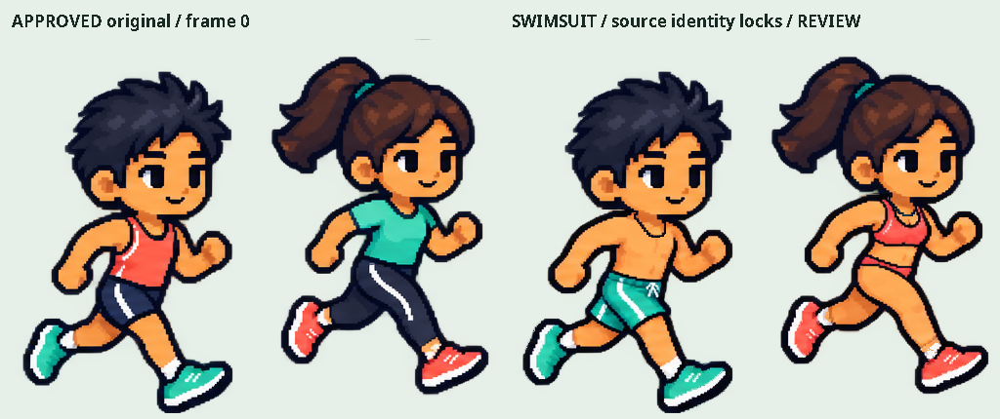
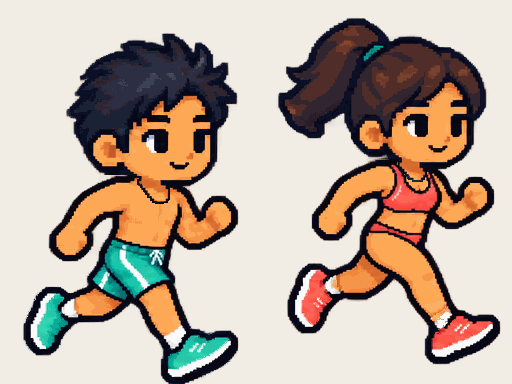
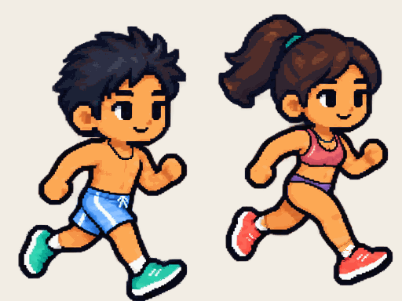
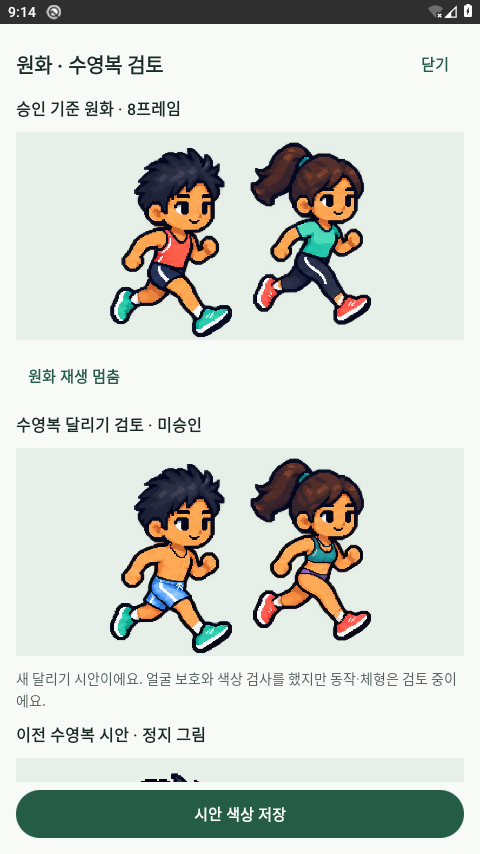
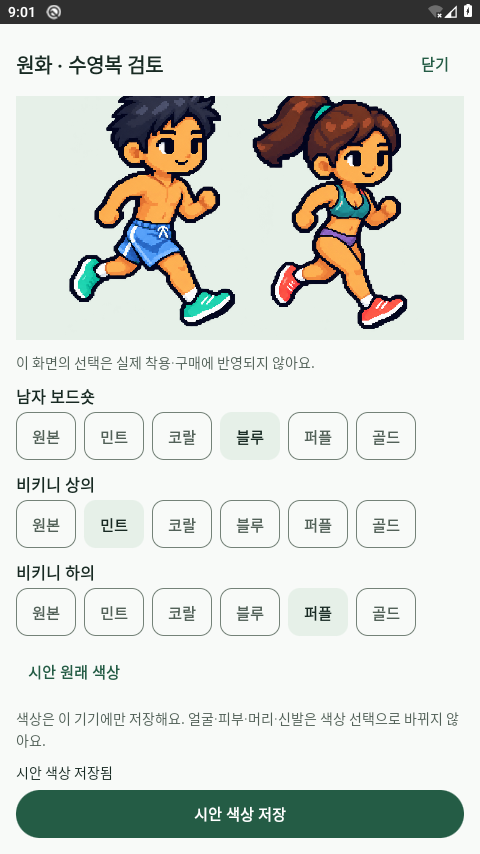
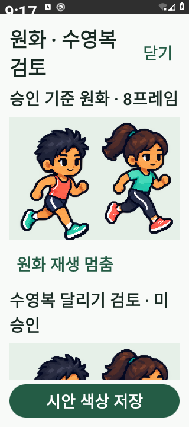
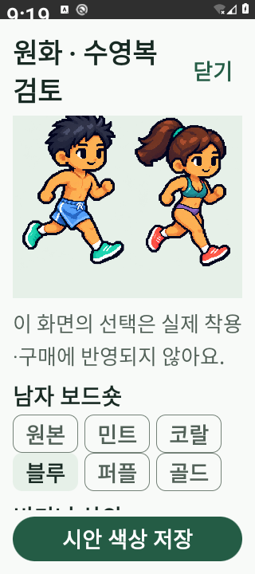

# 수영복 8프레임·실제 Android 검토 — 2026-10-27

후속 상태: 같은 날 이후 Maven 접근이 가능해져 전체 런모니 앱을 빌드·실행했고, 홈에 남은 v0.4 렌더러를 승인된 기본 전신 원화로 교체했다. [후속 실제 앱 화면·검증](../../../APP_REVIEW_20261027.md)을 우선 확인한다. 아래 전체 앱 403과 미복구 설명은 **이 단계 당시의 기록**이다. 수영복 승인·58종 레이어 복구가 완료된 것은 아니다.

요약: 승인 v0.3을 참조한 남녀 수영복 8프레임 시안과 원본 얼굴 보호/의복 색 마스크를 추가했다. 클라우드에 Android 29를 실제 부팅해 **별도의 캐릭터 검토 APK**를 설치·실행하고 저장 복원과 그리기 호출을 확인했다. **전체 런모니 앱 실행, 58종 원화 복구, 새 디자인 승인 완료는 아니다.**

## 원화와 구현

- `swimwear-motion-generated.png`: image_gen으로 승인 전신 시트 전체를 직접 편집한 2048×768, 남녀 2행×8열 시안. 별도 신체 부품/관절을 생성·회전해 조립한 결과가 아니다. 원본 생성 파일도 `/workspace/generated_images/exec-d9d1a596-f875-4e34-9096-7dbf5c205854.png`에 남겼다.
- 원본 v0.3 SHA-256 `f9035f29ced0c7ba513dfe24cb727410a7204dc482fc457e806c7a9b3cdbfa65`를 보존했다. 생성 모델은 얼굴을 포함한 비의복 픽셀도 바꿨으므로 생성 PNG를 그대로 얼굴 보존 결과로 취급하지 않는다.
- `build-motion-masks.py`로 프레임별 원본 머리/얼굴·목 보호 영역 및 신발 천 보호 마스크를 작성했다. 런타임 `protectIdentity`는 그 영역에 **승인 원본 픽셀을 직접 복사**한다. 원본 파일에는 쓰지 않는다. 보호 마스크 726,361픽셀 중 생성 결과와 달랐던 725,968픽셀을 원본으로 되돌렸다. 이 수에는 투명 배경도 포함되므로 얼굴 면적이나 미적 점수로 해석하지 않는다.
- 새 시트에도 보드숏·비키니 상의·하의의 프레임별 의복 마스크와 독립 팔레트를 적용한다. 피부 추정/색 분류는 오프라인 마스크 작성 단계에만 쓰며 앱은 명시적 마스크만 읽는다. 피부를 의상색으로 칠하거나 전신 hue를 바꾸지 않는다.
- 실제 Android 실행에서 셀 위쪽에 이전 행 신발 픽셀이 섞이는 현상을 확인했다. 표시용 `reviewPair`는 캐릭터 머리가 없는 셀 상단 여백 12px만 투명하게 한다. 원본 PNG와 정확한 원본 셀 추출 함수는 보존한다. 호스트 회귀 검사는 이 여백 밖 모든 픽셀이 그대로인지 확인한다.
- 검토 화면에 원본과 새 수영복 달리기 재생을 함께 연결했다. 색 선택과 기기 별도 저장은 기존 검토 설정을 재사용한다. 본래 옷장/지도 렌더러·58종 카탈로그·보유권·포인트·서버 JSON 계약은 바꾸지 않았다.

**시안은 미승인이다.** 원본 얼굴 영역을 복사한 사실이 전체 체형·동작·색 경계의 시각적 승인을 뜻하지 않는다. 프레임 배열은 만들었지만 팔/다리 위상과 7→0 연결의 자연스러움은 추가 검토 대상이다. 여자 화면 왼쪽 팔 동작까지 최종 승인받았다고 표시하지 않는다. 특수 세트와 전체 58종의 의복 형태 교체/가림 레이어는 아직 남아 있다. 실제 `MiniMi`/지도에 남은 v0.4 리그도 복구 완료가 아니다.

## 호스트 검토 출력

이 절의 PNG/GIF는 Java/ImageIO 출력이며 Android 캡처가 아니다. GIF는 손실 색 양자화가 있어 원본 픽셀 동등성 검사는 PNG/ARGB 배열에서 수행했다.







새 동작 시트의 216가지 팔레트 조합에서 alpha 보존, 의복 밖 변경 0, 원본 보호 영역 동일성을 확인했다. 정지 시안의 기존 216조합과 별도 검사다. [호스트 검사 결과](motion-verification.json) 및 앱 자산 `avatars/reference-review/motion-manifest.json`에 입력/마스크 해시를 기록했다.

## 실제 Android 실행

사용자의 ‘가능하게는 못함? 에뮬레이터?’ 요청으로 **클라우드 전용** AVD 실행을 허용했다. 사용자 PC AVD 제외는 유지한다. 이 머신에는 `/dev/kvm`과 USB 기기가 없어서 Android Emulator 37.3.5의 명시적 `ANDROID_I_WANT_MY_TCG=yes`와 `-accel off`로 실행했다. AOSP Android 29 x86_64, CPU 2개, RAM 2048MiB, headless SwiftShader, snapshot 비활성 구성이다. 부팅 완료 `sys.boot_completed=1`, ADB 기기 상태, 실제 앱 PID/ResumedActivity와 화면을 확인했다. 두 번째 부팅 로그는 107,392ms다.

테스트 APK는 **`com.runmoni.avatarreview` / `review-local` / code1**이다. 실제 `AvatarReferenceDialog`, `AvatarReferenceReview`, `GarmentPalette`, `RunmoniTheme` 소스와 자산을 사용하고, Activity와 작은 안내 함수만 검사 앱에서 구성했다. 소스 복사본의 해시는 [실행 검증 JSON](android-review/verification.json)에 기록했다. 기존 런모니 릴리스 키를 사용하지 않고 별도 로컬 테스트 debug 키로만 서명했으며, 공개 게시나 업데이트로 배포하지 않았다.

### 실제 Android 캡처

다음 이미지는 **Android 29에서 캡처한 별도 검토 앱 화면**이다. 전체 런모니 화면으로 표시하지 않는다.









### 확인 결과와 한계

| 항목 | 결과 |
|---|---|
| 검토 APK 빌드·설치 | 성공. 오프라인 재빌드와 저장한 설치 명령의 재실행도 확인 |
| 화면 실행 | 실제 PID, ResumedActivity=`com.runmoni.avatarreview/.ReviewActivity`, 캡처로 확인 |
| 새 동작의 실제 그리기 호출 | 테스트 전용 관찰자로 0..7 모두 확인. 화면에 표시된 FPS 측정이나 자연스러움 검사는 아님 |
| 색상 조작·기기 저장 | 보드숏3/상의1/하의4를 UI에서 선택·저장, 실제 SharedPreferences 확인 |
| 앱 강제 종료·재실행 | 선택값 복원 및 체크된 블루/민트/퍼플 UI 확인. 재부팅·검토 APK 갱신 뒤에도 유지 |
| 화면 조건 | 480dp 기본/글씨200%, 320dp·글씨200% 캡처와 스크롤·고정 저장 버튼 확인. 전체 접근성/상호작용 행렬을 완료했다는 뜻은 아님 |
| 앱 crash 버퍼 | 최종 검사 시 비어 있음 |
| OS 안정성·속도 | **한계 있음.** System UI ANR 1회 발생, Wait 후 복구. 소프트웨어 에뮬레이션을 안정적 성능 검증 환경으로 표시하지 않음 |
| 앱 시작 시간 | 일부 `am start -W`가 timeout 또는 Launcher로 결과를 반환. 이후 실제 PID/ResumedActivity/화면을 확인. warm 호출은 기존 Activity에 전달되어 status ok. 정상 cold-start 시간으로 합산하지 않음 |
| 종료 | 화면 크기/글씨/시스템 애니메이션 값을 복원하고 해당 AVD의 PID 소유권을 확인해 종료. 활성 qemu 없음. 종료된 zombie 엔트리는 실행 중 VM이 아님 |

KVM 없는 머신에서도 **부팅·화면·저장 검증을 가능하게 만든 것**이며 쾌적한 실시간 테스트 성능을 보장하지 않는다. 기기 GPS·배터리·블루투스·Google 로그인·LiveKit 실제 통신과는 별개다.

## 전체 앱 빌드의 외부 차단

원래 프로젝트의 `:app:compileDebugKotlin`도 시도했다. 첫 오프라인 실행은 KSP 캐시 부족으로 실패했고, 필요한 일반 의존성을 채운 온라인 실행은 `:app:checkDebugAarMetadata`에서 다음 두 의존성의 **403**으로 중단됐다.

- `com.naver.maps:map-sdk:3.24.0` → `repository.map.naver.com`
- LiveKit의 `com.github.davidliu:audioswitch:039a35aefab7747c557242fa216c9ea11743b604` → `jitpack.io`

SDK 36/build-tools 36과 JDK21/Gradle8.13은 설치했다. 원래 build.gradle을 바꾸지 않고 임시 init script로 설치된 build-tools 36을 선택했다. 의존성 검증이나 TLS를 끄거나 다른 저장소로 우회하지 않았다. **전체 `com.runmoni.app` APK 빌드·설치·실행은 완료되지 않았다.** 두 도메인의 허용 요청과 재사용 설치/시작 지침을 환경 설정 초안에 저장했으며, 초안 저장은 현재 네트워크 적용/게시 완료가 아니다. 환경 설정에서 검토·저장·게시한 뒤 해당 작업을 재시도해야 한다.

## 재현과 보존

저장소 루트에서 순차 실행한다. 설치 도구는 공식 Google XML/Adoptium·Gradle 체크섬과 TLS를 유지하고 `work/cloud-android`에만 준비한다. 최초 약 1GB 이상의 도구/시스템 이미지가 필요하며, 이후 올바른 캐시를 재사용한다.

```sh
python3 scripts/cloud/prepare-android.py
python3 scripts/cloud/avatar-review.py build       # 기본 offline, 최초 캐시 준비만 --online
python3 scripts/cloud/avatar-review.py start       # 클라우드 전용 1개. PC AVD 실행 안 함
python3 scripts/cloud/avatar-review.py status      # boot_completed: 1까지 확인
work/cloud-android/sdk/platform-tools/adb -s emulator-5556 install -r \
  work/cloud-android/review-app/build/outputs/apk/debug/RunmoniAvatarReview-debug.apk
work/cloud-android/sdk/platform-tools/adb -s emulator-5556 shell am start -W \
  -n com.runmoni.avatarreview/.ReviewActivity
# 실제 화면/목표 프로세스/로그를 추가 확인하고, 검증 후 반드시 종료
python3 scripts/cloud/avatar-review.py stop
```

SDK 도구의 `ANDROID_USER_HOME`만으로 ADB의 고정 `~/.android` 경로가 바뀌지 않았다. 이 머신에서는 정상 권한 승인 흐름으로 해당 디렉터리와 로컬 ADB 서버를 준비했다. `HOME`을 재지정하거나 인증 키 내용을 출력하지 않았다. 서비스/프로세스는 게시나 새 작업 복원 후 살아 있다고 가정하지 않는다. 새 작업에서의 snapshot 복원은 독립 검증하지 않았다.

진행 중 실패도 보존한다: 최신 에뮬레이터의 기본 `-accel off` 거부 후 도구가 안내한 TCG opt-in 적용, ADB 기본 경로 쓰기 실패 해결, 검토 앱 별도 debug keystore 준비 후 빌드 성공, 잘못된 APK 파일명 대신 Gradle output metadata의 실제 파일명 사용, UIAutomator의 `selected` 대신 FilterChip의 실제 `checked` 상태를 사용해 복원 검사 수정. 화면 크기 변경 직후 검정 캡처는 전환 중 결과로 제외하고 안정된 실제 화면을 보존했다. SDK metrics 쓰기/업데이트 확인 경고와 TCG CPU 기능 경고도 관측했으며 도구 검증을 해제해 성공시킨 것은 아니다.

기본 Java21의 `javac` 실행 파일이 없었던 것과 JDK compiler 모듈의 유무는 별개였다. 후속 확인에서 compiler 모듈을 찾았고, 전체 Android 도구는 공식 Adoptium JDK21로 명시해 재현했다. 이전 ‘JRE만 있다’는 진단은 이 범위로 정정한다.

앱 버전0.1.5-dev/code6·기존 APK sourceRevision `75c39ca900b140cfb02c1a47807a5955c8b8db7f`·공개 피드·대시보드 다운로드는 유지한다. Aseprite를 실제 실행하거나 `.aseprite` 원본을 제작한 작업이 아니다. 새 수영복은 image_gen 원화와 별도 소프트웨어 마스크/합성 결과이며 승인/저작권을 새로 주장하지 않는다.
